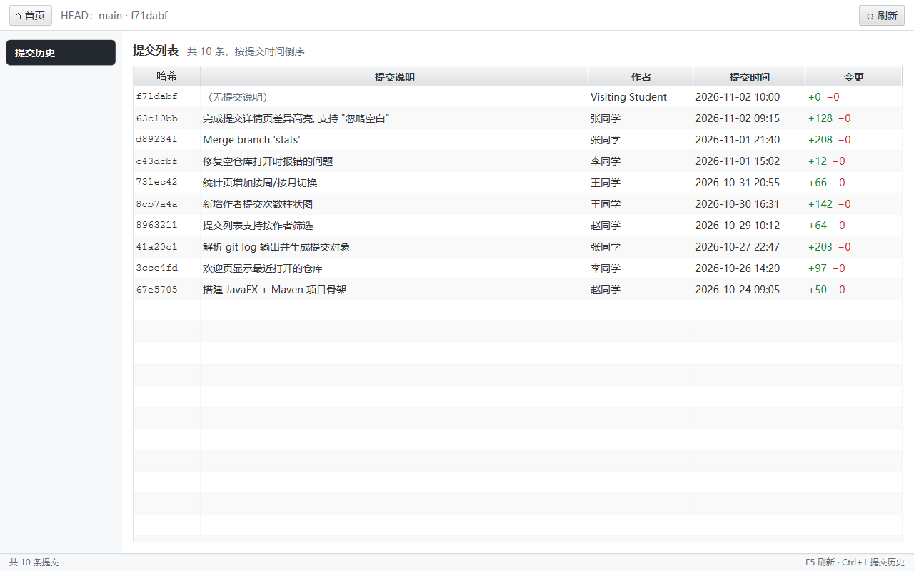

# GitViz · Git 提交历史可视化与仓库分析工具

帮助 Git 初学者看懂本地仓库的提交历史：提交列表与时间线、贡献统计图表、提交差异。第 9 组 PBL 课程项目，Java + JavaFX + Maven。程序只读取仓库，不会修改仓库内容。

> 开发中。目前可以输入仓库路径、读取全部提交并在提交历史页列出。进度见 [Issues](https://github.com/Tippydes/GitViz/issues)。



## 运行要求

| 依赖 | 版本 | 说明 |
| --- | --- | --- |
| JDK | 17 或更高 | 在 JDK 17 和 21 上验证过 |
| Git | 2.31 或更高 | 程序通过命令行调用 git，命令行里 `git --version` 能看到版本号即可 |
| JavaFX | 22.0.2 | 由 Maven 自动下载，不需要单独安装；选择理由见 [ADR 0001](docs/adr/0001-javafx-22-on-jdk-17.md) |
| Maven | 3.9.16 | 由 Maven Wrapper 自动下载，不需要单独安装 |

## 构建与运行

Windows（PowerShell 或 cmd）：

```
.\mvnw.cmd javafx:run
.\mvnw.cmd test
```

macOS、Linux 或 Git Bash：

```
./mvnw javafx:run
./mvnw test
```

`javafx:run` 启动程序，`test` 运行全部测试。第一次运行会下载 Maven 和依赖，需要联网，可能要几分钟。

在 IDE 里直接运行时，入口类选 `edu.pbl.gitviz.Launcher`。

## 代码结构

```
src/main/java/edu/pbl/gitviz/
├── model/        不可变的数据对象（CommitRecord、FileChange、HeadInfo）
├── service/      服务层（RepositoryLoader、RepositorySession、TimeDisplay）
│   └── git/      只读调用 git：GitCommand 白名单、GitRunner 进程管理、GitLogParser、GitService
└── ui/           界面层（MainWindow、WelcomeView = P1、WorkspaceView、HistoryView = P3）
src/test/java/edu/pbl/gitviz/testutil/TestRepo.java   在临时目录里用 git 现场造测试仓库
```

界面层只依赖服务层，服务层不接触界面对象，所以服务层和数据层都能脱离界面单独测试。

## 文档

- [系统设计文档](docs/design/system-design.md)：页面原型、页面跳转、数据持久化设计
- [开题文档](docs/design/proposal.md)：项目目标、需求范围、验收标准
- [AGENTS.md](AGENTS.md)：开发约定（同时供 coding agent 阅读）
