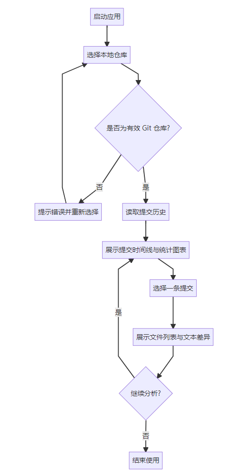

# Git 提交历史可视化与仓库分析工具 · 开题文档

第 9 组

> 由 Word 原件《第9组开题文档.docx》转换而来。

## 一、项目背景

Git 是软件开发中常用的版本控制工具，但对于刚开始学习 Git 的学生而言，提交记录、作者信息、分支关系和文件差异通常分散在多个命令及文本输出中。当仓库提交数量增加时，初学者需要手动执行命令并阅读较长的日志，才能理解项目的演进过程、不同成员的贡献情况以及某次提交具体修改了哪些内容。

本项目拟开发一款面向计算机专业学生和 Git 初学者的桌面应用。用户选择本地 Git 仓库后，系统读取仓库的提交历史及差异信息，并以时间线、统计图表和差异视图展示。应用定位为辅助理解和分析工具，不替代 Git 本身，也不在第一版中修改仓库内容。

## 二、项目目标与创新点

### 2.1 项目目标

- 将本地 Git 仓库的提交历史以清晰的图形界面呈现。
- 对提交者、提交时间和代码变更规模进行基础统计。
- 支持查看单次提交涉及的文件和文本差异，帮助用户理解代码演进。
- 在限定开发周期内完成可运行、可测试、可演示的 Java 桌面应用。

### 2.2 项目创新点

- 信息整合：将提交历史、作者贡献统计和提交差异整合到同一桌面界面，减少用户在多个 Git 命令之间切换的成本。
- 可视化辅助理解：通过时间线和图表呈现原本以文本为主的版本信息，降低初学者理解仓库演进过程的门槛。
- 安全边界明确：第一版仅读取用户主动选择的本地仓库，默认不执行提交、重置、合并等修改性操作，降低误操作风险。

本项目的创新主要体现在面向初学者的交互整合和可视化呈现，而非提出新的版本控制算法。

## 三、需求分析

系统核心功能控制在以下三项：

### 3.1 功能一：提交历史可视化

用户选择一个本地 Git 仓库后，系统读取提交哈希、作者、提交时间和提交说明，以时间线或列表展示提交记录，并提供按作者或时间范围筛选的能力。

输入：本地仓库路径、可选筛选条件。输出：提交列表及提交基本信息。

### 3.2 功能二：仓库贡献统计

系统基于可读取的提交记录统计各作者提交次数、提交时间分布及提交涉及的增删行数，并以柱状图或折线图展示。统计结果用于描述仓库历史，不直接代表个人工作质量。

输入：已读取的仓库提交记录。输出：作者统计、时间分布和变更规模图表。

### 3.3 功能三：提交差异查看

用户选择一条提交后，系统展示该提交涉及的文件列表、增删行数和文本差异。对二进制文件或无法解析的差异，界面显示提示，不尝试将其作为普通文本呈现。

输入：用户选择的提交。输出：文件变更清单及可读的文本差异。

## 四、业务流程

主业务流程如下：

1. 启动应用。
1. 用户选择本地 Git 仓库目录。
1. 系统校验目录是否为有效 Git 仓库。
1. 读取提交历史及必要的差异信息。
1. 展示提交时间线和仓库统计。
1. 用户选择某条提交并查看文件差异。
1. 用户切换筛选条件或选择其他提交；也可结束使用。

## 五、技术方案

- 开发语言：Java。
- GUI 框架：JavaFX。
- 版本信息读取：通过 Java ProcessBuilder 调用本机 Git CLI，并解析结构化输出。
- 构建工具：Maven。
- 图表：JavaFX Charts。
- 测试：JUnit 5；使用临时测试仓库验证解析和统计逻辑。
- 数据存储：第一版优先即时读取本地仓库；如需保存偏好设置，可使用轻量本地配置文件。

## 六、可行性与风险控制

- 技术可行性：Git CLI 已提供日志与差异查询能力，Java 可通过 ProcessBuilder 调用外部进程，JavaFX 可完成桌面展示。
- 范围控制：第一版只支持本地仓库和常见文本差异，不开发账号系统、云端同步、在线协作或自动修改仓库。
- 兼容性风险：不同操作系统和 Git 版本的输出可能存在差异，应使用明确的输出格式并对异常情况进行提示。
- 安全风险：将仓库路径作为独立参数传递给进程，不拼接成 shell 命令；默认只执行读取操作，避免误修改仓库。
- 测试风险：准备包含多个作者、多个提交、空仓库及异常路径的测试样例，验证边界情况。

## 七、预期成果与验收标准

- 能够选择有效的本地 Git 仓库并显示提交历史。
- 能够按作者或时间筛选提交记录。
- 能够展示至少一种作者贡献统计图表和一种时间分布图表。
- 能够查看选定提交涉及的文件及文本差异。
- 面对无效路径、非 Git 目录或 Git 命令失败时，能够显示明确提示而非直接崩溃。
- 提交项目源代码、README、开题报告和必要的测试说明。
