# Git 提交历史可视化与仓库分析工具 · 系统设计文档

原型设计与数据持久化设计 · 第 9 组 · 2026 年 11 月

> 由 Word 原件《第9组系统设计文档.docx》转换而来。实现以本文件为准；设计有变动时直接修改本文件。

## 目录

- [一、设计概述](#一设计概述)
  - [1.1 设计依据与范围](#11-设计依据与范围)
  - [1.2 设计原则](#12-设计原则)
  - [1.3 系统总体结构](#13-系统总体结构)
- [二、原型设计与交互](#二原型设计与交互)
  - [2.1 页面构成与整体布局](#21-页面构成与整体布局)
  - [2.2 主要页面原型说明](#22-主要页面原型说明)
  - [2.3 交互流程与跳转逻辑](#23-交互流程与跳转逻辑)
- [三、数据持久化设计](#三数据持久化设计)
  - [3.1 持久化范围：哪些数据需要保存](#31-持久化范围哪些数据需要保存)
  - [3.2 存储位置与目录结构](#32-存储位置与目录结构)
  - [3.3 数据模型与关联设计](#33-数据模型与关联设计)
  - [3.4 持久化文件设计详表](#34-持久化文件设计详表)
  - [3.5 文件存储格式选型](#35-文件存储格式选型)
  - [3.6 数据的读写时机](#36-数据的读写时机)
  - [3.7 异常情况与数据一致性](#37-异常情况与数据一致性)
  - [3.8 持久化测试要点](#38-持久化测试要点)
- [四、小结](#四小结)

## 一、设计概述

### 1.1 设计依据与范围

本文档是第 9 组 PBL 项目“Git 提交历史可视化与仓库分析工具”的系统设计说明，承接开题文档中确定的目标、功能范围与技术路线，重点回答两个问题：第一，用户看到的界面是什么样子、在各界面之间如何流转（原型设计与交互）；第二，哪些数据需要长期保存、以什么结构和格式保存在本地文件中、何时读写（数据持久化设计）。

根据开题文档，系统的核心功能有三项：（1）选择本地 Git 仓库，浏览并按作者、时间筛选提交历史；（2）以图表展示作者贡献和提交时间分布；（3）查看某次提交修改了哪些文件以及具体的文本差异。系统面向刚接触 Git 的学生和课程项目小组，只读取仓库、不修改仓库内容，也没有账号体系。

本设计遵守课程给出的两条技术约束：界面基于 Java GUI 框架实现（本项目选用 **JavaFX**，配合 Maven 构建、JavaFX Charts 绘图、JUnit 5 测试）；所有需要长期保存的数据都通过本地文件持久化，**不使用任何数据库**（包括 SQLite、H2 等嵌入式数据库）。用到的 Gson 和 Apache Commons CSV 只是负责文本格式解析的普通 Java 库，由 Maven 管理，不提供数据库功能。

开题文档提出“第一版优先即时读取本地仓库；如需保存偏好设置，可使用轻量本地配置文件”。本设计在此基础上做了三处有节制的补充，并说明它们与原范围的关系：

- **分析缓存**：仓库的提交元数据在首次打开时写入本地 CSV 缓存，再次打开时只读取新增提交。缓存可以随时删除、也可在设置中关闭，删除后不会丢失任何信息，因为 Git 仓库始终是唯一的数据来源，“即时读取仓库”的原则没有改变。
- **提交书签与笔记**：初学者阅读历史时常需要记录“这次提交为什么这样改”，书签让用户为提交加标签、写笔记。
- **筛选方案**：把常用的“作者 + 时间范围 + 关键词”组合命名保存，下次一键应用。

书签与筛选方案属于辅助功能，只在核心数据之上增加一层用户数据，不改变三项核心功能的范围；若开发进度紧张，可以整体推迟而不影响验收标准。它们也是本系统中真正由用户创作、丢失后无法从仓库恢复的数据，因此是持久化设计的重点。

本文档的范围限于原型与交互、数据持久化两部分。服务层的类设计、Git 输出解析的细节和完整测试计划将在后续实现文档中给出，本文只在与持久化直接相关的地方（如缓存的生成命令、持久化测试要点）作必要说明。

### 1.2 设计原则

以下原则贯穿后续所有设计决策，后文在解释“为什么这样设计”时会反复引用：

- **只读与安全**：程序只执行只读的 Git 子命令（白名单：`--version`、`rev-parse`、`log`、`show`、`merge-base --is-ancestor`、`rev-list --count`），通过 ProcessBuilder 以参数列表方式调用，仓库路径作为独立参数传入，从不拼接成命令行字符串；程序的任何数据都不写入被分析的仓库目录。
- **面向初学者**：所有提示使用中文、说明原因并给出下一步操作；涉及“父提交”“合并提交”“分离头指针”等术语时提供悬停解释；常见环境问题（未安装 Git、选错目录）在用户操作之前就给出提示。
- **统计口径透明**：统计页始终显示当前统计范围与计算规则，并注明统计结果只描述提交历史，不代表个人工作量或代码质量。
- **数据可恢复**：用户数据采用原子写入并保留备份，文件损坏时自动回退；缓存数据可由仓库重新生成，任何时候删除都是安全的。
- **界面不卡顿**：Git 命令与文件读写都在后台线程执行，JavaFX 应用线程只负责界面更新。
- **简单优先**：文件数量少、格式可读，能用一个文件解决的不拆成多个，能在内存中计算的不保存。

### 1.3 系统总体结构

系统采用三层结构（表 1）。界面层只依赖服务层；服务层负责调用 Git 和组织业务流程，并通过持久化层读写本地文件；持久化层不依赖界面层，因此可以脱离界面单独进行单元测试。三层之间传递的是不可变的数据对象（如提交记录、仓库记录），这样后台线程产生的结果可以安全地交给界面线程使用。

**表 1　系统分层与主要组件**

| 层次 | 主要组件 | 职责 |
| --- | --- | --- |
| 界面层 <br>（JavaFX） | MainWindow、WelcomeView、WorkspaceView、HistoryView、StatsView、CommitDetailView、BookmarksView 及各对话框 | 页面布局、接收用户输入、绘制图表；只在 JavaFX 应用线程中运行，不直接访问文件和 Git |
| 服务层 | GitService、RepositoryLoader、StatsService、DiffService、RepositorySession、FilterState | 执行白名单内的 Git 命令并解析输出；组织“打开仓库”流程；按筛选条件计算统计；按需读取差异；保存当前会话状态 |
| 持久化层 | SettingsStore、RepositoryStore、PresetStore、BookmarkStore、AnalysisCache、PersistenceExecutor | 读写 ~/.gitviz 下的 JSON 与 CSV 文件；加载时校验与修复；备份与原子写入；由单线程执行器排队写盘 |
| 外部依赖 | Git 命令行（≥ 2.31）、本地文件系统 | 提供提交数据；保存程序数据 |

## 二、原型设计与交互

### 2.1 页面构成与整体布局

系统是一个单窗口桌面应用。主窗口内只有两种根视图：未打开仓库时显示**欢迎视图**，打开仓库后显示**工作区视图**；其余界面都以模态对话框的形式覆盖在当前视图之上。界面层次如图 1所示，各页面的功能定位与主要内容区域见表 2。

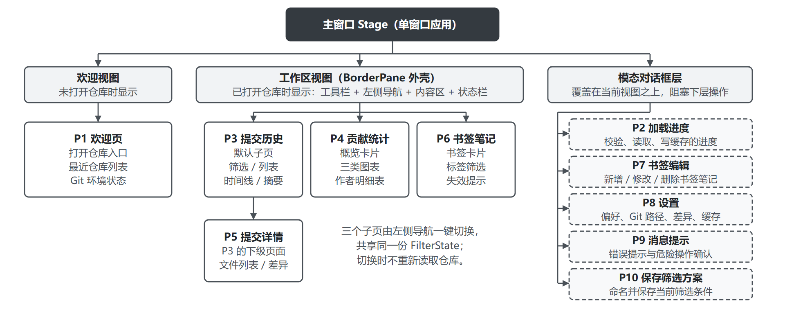

*图 1　界面层次结构*

选择“单窗口 + 模态对话框”而不是多窗口，主要考虑初学者的使用习惯：多个独立窗口容易被遮挡或找不到，而且不同窗口之间要同步同一份数据。单窗口时，同一时刻只有一个仓库处于打开状态，所有子页面共享同一个会话对象，数据只有一份，状态不会互相矛盾。对话框都设为窗口模态，打开期间阻塞主窗口，用户必须先确认或取消，这样可以保证“正在编辑的数据”只有一处。

**表 2　页面清单**

| 编号 | 页面 | 类型 | 功能定位 | 主要内容区域 | 对应需求 |
| --- | --- | --- | --- | --- | --- |
| P1 | 欢迎页 | 主视图 | 应用入口；打开新仓库或最近仓库 | Git 环境状态、打开区（拖放 / 选择 / 输入路径）、最近仓库列表、设置入口 | 选择仓库 |
| P2 | 加载进度 | 模态对话框 | 显示校验与读取进度，可随时取消 | 仓库路径、步骤清单、进度条、取消按钮 | 选择仓库 <br>异常处理 |
| P3 | 提交历史 | 工作区子页 <br>（默认） | 浏览、筛选提交，预览提交摘要 | 工具栏、左侧导航、筛选栏、提交列表 / 时间线、提交摘要、状态栏 | 历史浏览 <br>筛选 |
| P4 | 贡献统计 | 工作区子页 | 查看作者贡献与时间分布 | 统计范围、概览卡片、柱状图、折线图、堆叠条形图、作者明细表 | 统计图表 |
| P5 | 提交详情与差异 | P3 的下级页面 | 查看单个提交的变更文件与文本差异 | 导航栏、提交信息头、变更文件列表、差异区、差异选项 | 差异查看 |
| P6 | 书签笔记 | 工作区子页 | 浏览、搜索本仓库的书签与笔记 | 搜索与标签筛选栏、书签卡片列表 | 辅助：笔记 |
| P7 | 书签编辑 | 模态对话框 | 新建、修改、删除书签 | 提交信息、标签输入、笔记正文、操作按钮 | 辅助：笔记 |
| P8 | 设置 | 模态对话框 | 修改偏好、Git 路径、差异与缓存选项 | 常规、Git 环境、差异显示、缓存与数据四个分组 | 环境配置 |
| P9 | 消息提示 | 模态对话框 | 错误提示与危险操作确认 | 图标、标题、说明、技术详情（可折叠）、操作按钮 | 异常处理 |
| P10 | 保存筛选方案 | 模态对话框 | 把当前筛选条件命名保存 | 方案名称、条件摘要、默认方案选项 | 辅助：方案 |

**工作区布局**。 工作区采用 JavaFX 的 BorderPane 作为外壳，四个区域在三个子页面之间保持不变：顶部是**工具栏**（首页、仓库切换下拉框、当前 HEAD、刷新、设置）；左侧是**导航栏**（提交历史、贡献统计、书签笔记）；底部是**状态栏**（数量统计、缓存状态、快捷键提示）；中间的**内容区**随导航切换为 P3、P4 或 P6。P5 不是独立的子页，而是在内容区中替换 P3 显示的下级页面：差异需要尽可能大的显示面积，弹出对话框会显得局促；同时 P5 保留“返回列表”和“上一条 / 下一条”，用户看完差异回到列表时滚动位置与选中行都不变。

窗口最小尺寸为 960 × 640 像素，默认 1280 × 800。宽度不足时，P3 右侧的摘要区和 P4 的图表网格会改为上下排列，不出现水平滚动条。

**原型图约定**。 本节的原型图为线框图，只表达布局、内容和交互，不代表最终配色与字体。图中橙色圆形数字是区域编号，与正文中的①②③……一一对应；颜色只用于表达语义：绿色表示新增，红色表示删除，橙色表示警告。为了让原型更容易理解，图中统一使用一个虚构的示例仓库“PBL-第9组”（路径 D:\pbl\git-visualizer，共 58 次提交、4 位作者），后文数据持久化部分的 JSON / CSV 示例也使用同一组数据，便于对照。

### 2.2 主要页面原型说明

#### 2.2.1 P1 欢迎页

欢迎页是程序启动后看到的第一个界面（图 2），承担两件事：确认运行环境可用，以及用最少的操作打开仓库。页面上半部分是标题区，下半部分左右分栏：左侧用于打开新仓库，右侧列出最近打开过的仓库。

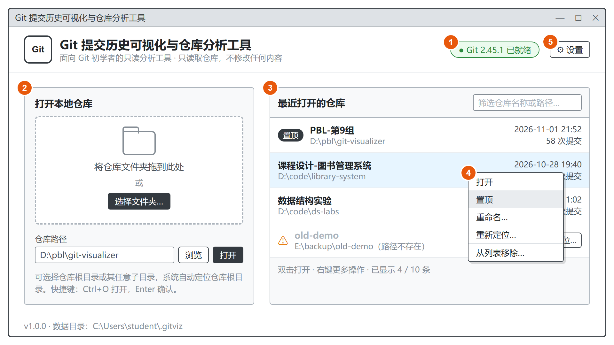

*图 2　P1 欢迎页原型（含最近仓库右键菜单）*

**① Git 环境状态**。 程序启动后在后台执行 `git --version`，结果以状态胶囊的形式显示在右上角，共有四种状态：“检测中”（灰色）、“已就绪”（绿色，附版本号）、“未检测到 Git”（红色）和“版本过低”（橙色，低于 2.31 时出现，因为缓存构建用到的 `--diff-merges` 选项需要该版本）。红色和橙色状态可以点击，直接打开设置对话框中的“Git 环境”分组。之所以把检测放在欢迎页，是因为“没装 Git”或“PATH 未配置”是初学者最常见的问题，提前提示可以避免用户选好目录后才遇到一个难以理解的失败。

**② 打开本地仓库**。 提供三种等价的方式：把文件夹拖到虚线框内；点击“选择文件夹…”调出系统目录选择器（初始目录为上次浏览的位置）；在路径框中输入或粘贴路径后点“打开”或按 Enter。用户可以选择仓库根目录，也可以选择其中任意子目录，程序会用 `git rev-parse --show-toplevel` 自动定位根目录。路径框为空时“打开”按钮不可用；拖入的若是文件而不是文件夹，虚线框内直接提示“请拖入文件夹”，不进入后续流程。三种方式最终都把路径交给 P2 统一校验。

**③ 最近打开的仓库**。 列表先显示置顶的仓库，其余按最近打开时间倒序排列。每行显示名称、路径、最近打开时间和上次打开时的提交数；右上角的输入框可按名称或路径即时过滤。双击某一行即可打开该仓库。路径已经不存在的记录（如图中的 old-demo）以灰色显示，前面加警告图标，并在行内提供“重新定位…”按钮。列表底部显示“已显示 4 / 10 条”，其中 10 是设置中的最近仓库数上限，置顶的记录不计入上限。首次使用、列表为空时，这一区域显示“还没有打开过仓库，可以把文件夹拖到左侧”的空状态提示。

**④ 右键菜单**。 提供打开、置顶 / 取消置顶、重命名、重新定位、从列表移除五项操作。重命名只修改显示名称（1～50 字），不影响磁盘上的文件夹；重新定位用于仓库文件夹被移动的情况：用户选择新位置后，程序比较新位置的根提交哈希与记录中保存的值，一致则更新路径，书签、筛选方案与缓存全部保留；不一致时弹出 P9 提醒“这可能不是同一个仓库”，由用户决定是否继续。从列表移除需要在 P9 中确认，详见 2.2.6 节。

**⑤ 设置入口**，打开 P8。页面底部还显示程序版本和数据目录位置（点击可在资源管理器中打开），让用户清楚地知道程序把数据保存在哪里。

#### 2.2.2 P3 提交历史页

提交历史页是打开仓库后的默认页面，也是使用频率最高的页面（图 3）。页面自上而下分为筛选栏和内容区，内容区左侧是提交列表，右侧是所选提交的摘要。

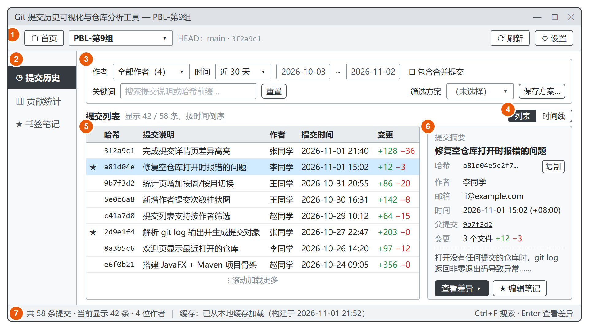

*图 3　P3 提交历史页原型*

**① 工具栏**（工作区共用）：“首页”回到 P1；仓库下拉框列出最近仓库，可直接切换，最后一项“打开其他…”回到选择目录的流程；其后显示当前分支和 HEAD 的短哈希，处于分离头指针状态时显示“分离头指针”并给出悬停解释；右侧是“刷新”和“设置”。

**② 左侧导航**：在提交历史、贡献统计、书签笔记三个子页之间切换，当前子页高亮，也可用 Ctrl+1/2/3 切换。切换时不重新读取仓库。

**③ 筛选栏**：包括作者（多选下拉框，每位作者后显示其提交数）、时间范围（全部 / 近 7 天 / 近 30 天 / 近 90 天 / 自定义）、起止日期（只在选择“自定义”时可编辑，其余情况只读地显示换算后的日期，例如图中“近 30 天”显示为 2026-10-03 ~ 2026-11-02）、“包含合并提交”复选框、关键词、“重置”，以及筛选方案下拉框和“保存方案…”按钮。筛选规则如下：

- 不同条件之间是“且”的关系，作者多选时作者之间是“或”的关系；作者列表为空表示全部作者。
- 日期按显示时区换算，起止日期都包含在内，即从起始日 00:00:00 到结束日 23:59:59。“近 30 天”等相对范围在应用时以当天为基准重新计算。
- 关键词不区分大小写，匹配提交说明，或在输入 4 位以上十六进制字符时匹配哈希前缀。
- 关键词输入后延迟 300 毫秒生效，避免每输入一个字都重新筛选；其余条件修改后立即生效。
- 筛选完全在内存中进行，不调用 Git：数据已在打开仓库时全部载入，预计对上万条提交逐条判断也只需数毫秒。
- 应用某个筛选方案后，其条件写入当前筛选状态；用户再手动修改任一条件时，方案下拉框显示“（已修改）”，提醒当前条件已与方案不同。

**④ 视图切换**：列表视图与时间线视图使用同一份筛选结果。时间线视图把提交按日期分组，用竖线和圆点串联，合并提交以空心节点表示，更直观地展示“什么时候集中提交”；列表视图信息密度更高，适合逐条查找。

**⑤ 提交列表**：列出短哈希、提交说明、作者、提交时间和增删行数，按作者时间倒序排列（时间未知的排在最后），标题旁显示“显示 42 / 58 条”。已加书签的提交前显示 ★。列表使用 TableView 的虚拟化机制，只渲染可见的行，因此“滚动加载更多”只是渲染层面的按需绘制，数据已全部在内存中。单击一行在右侧显示摘要；双击或按 Enter 进入 P5；右键菜单提供“查看差异”“复制完整哈希”“加入书签”“只看该作者的提交”。

**⑥ 提交摘要**：显示提交标题、完整哈希（可复制）、作者、邮箱、带时区的提交时间、父提交（可点击跳到父提交）、变更文件数与增删行数，以及提交说明正文的前几行。正文不在缓存中，选中时才用 `git show -s` 读取，并放入内存中的小型缓存。底部的“查看差异”进入 P5，“编辑笔记”打开 P7。设计摘要区的原因是：初学者浏览历史时常常只想快速看看某次提交“是谁、什么时候、改了多少”，单击就能预览，不必离开列表。

**⑦ 状态栏**：显示提交总数、当前显示数、作者数，以及缓存状态（“已从本地缓存加载”“已增量更新 12 条”“未启用缓存”“缓存损坏，已重新构建”等），右侧提示常用快捷键。

页面还设计了两种空状态：仓库没有任何提交时，内容区显示“该仓库还没有任何提交”，并说明可以先在命令行中完成第一次提交；筛选结果为空时显示“没有符合条件的提交”，并提供“重置筛选”链接。

#### 2.2.3 P4 贡献统计页

贡献统计页把当前筛选范围内的提交汇总成图表（图 4）。它与 P3 共享同一份筛选条件：在 P3 选了“近 30 天”，切换到 P4 看到的就是近 30 天的统计，两页的数字始终一致，用户不必在两处分别设置。


*图 4　P4 贡献统计页原型*

**① 统计范围**：用一句话说明当前统计的是哪些提交（作者、时间范围、是否包含合并提交），右侧“修改筛选”回到 P3 并聚焦筛选栏。

**② 概览卡片**：提交总数、参与作者数、时间跨度 / 活跃天数（有提交的天数）、代码增删行数。

**③ 作者提交次数**（柱状图）：按提交数从多到少排列，悬停显示次数和占比；作者超过 10 人时只画前 10 名，其余合并为“其他”。单击柱子跳回 P3，并把作者筛选替换为该作者，其他条件保持不变，方便用户从“谁提交最多”直接看到该作者提交了什么。

**④ 提交时间分布**（折线图）：横轴为时间段，纵轴为提交数。粒度根据时间跨度自动选择：14 天以内按日，180 天以内按周，更长按月，也可手动切换。没有提交的时间段按 0 绘制，而不是被跳过，否则折线会把空档“连”过去，产生误导。按周统计时一周从周一开始，日期边界按显示时区计算。

**⑤ 作者增删行**（堆叠条形图）：每位作者一条，绿色为新增行、红色为删除行，末尾标注合计。

**⑥ 作者明细**（表格）：列出提交数、占比、增加、删除和最近一次提交时间，点击表头排序，单击行同样跳回 P3 查看该作者的提交。

**⑦ 口径说明**：注明“统计结果仅描述仓库的提交历史，不代表个人工作量或代码质量”。这是开题时讨论过的伦理问题：课程小组可能用统计页来比较组员，程序应主动提醒提交次数和行数只是历史记录的一种描述。

统计口径的几处细节在这里一并说明：

- **作者识别**：以转为小写的邮箱作为作者的唯一依据，显示名取该邮箱最近一次提交使用的名字。读取历史时使用的 `%aN`、`%aE` 会应用仓库中的 .mailmap，因此同一个人用不同邮箱提交时，可以通过 .mailmap 合并；没有 .mailmap 时会被统计为两位作者，这是一个已知限制，P4 的帮助提示中会说明。
- **合并提交**：默认（未勾选“包含合并提交”）不参与任何统计；勾选后计入提交次数和时间分布，但仍不计入增删行，因为合并提交相对第一父提交的差异包含了被合并分支上已经统计过的修改，再计一次会重复。
- **二进制文件**：只计入变更文件数，不计入增删行。
- **不保存统计结果**：统计数据由 StatsService 根据筛选结果一次遍历算出，复杂度为 O(n)，预计一万条提交也只需几十毫秒，因此每次筛选变化都重新计算，不写入任何文件。保存统计结果不仅没有必要，还会带来“保存的结果与当前筛选条件不一致”的问题。

#### 2.2.4 P5 提交详情与差异页

提交详情页用于查看一次提交修改了哪些文件、每个文件具体改了什么（图 5）。从 P3 双击提交、在摘要区点“查看差异”或按 Enter 都会进入此页。

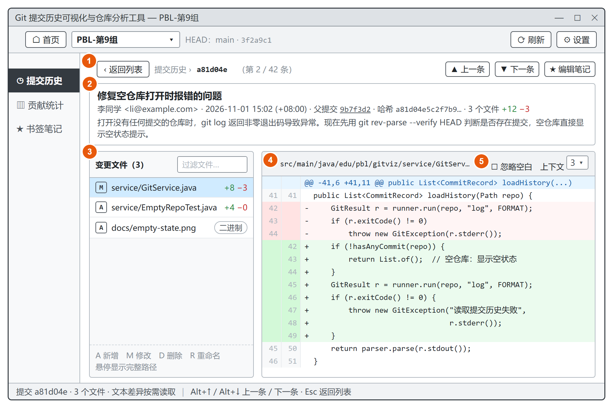

*图 5　P5 提交详情与差异页原型*

**① 导航栏**：“返回列表”和面包屑“提交历史 › a81d04e”都回到 P3（也可按 Esc）；“第 2 / 42 条”表示当前提交在 P3 筛选结果中的位置；“上一条 / 下一条”（Alt+↑ / Alt+↓）在筛选结果中前后移动，到达首尾时对应按钮不可用；“编辑笔记”打开 P7。

**② 提交信息头**：显示标题、作者与邮箱、带时区的时间、父提交链接（合并提交显示两个父提交）、哈希、文件数与增删行数，下方是完整的提交说明。

**③ 变更文件列表**：每个文件前用字母标出变更类型（A 新增、M 修改、D 删除、R 重命名、C 复制、T 类型变化），列表中只显示文件名和最后一级目录，悬停显示完整路径；重命名显示为“旧名 → 新名”；二进制文件不显示增删行，而显示“二进制”标记。文件列表直接来自缓存中的文件变更数据，不需要再调用 Git。默认选中第一个文件，文件较多时可用顶部输入框按名称过滤。

**④ 差异区**：顶部显示所选文件的完整路径，下方以统一差异格式显示内容：左侧两列为旧、新行号，删除行红底、新增行绿底，“@@”开头的块头单独一行。差异按文件即时读取（`git show` 指定提交和文件路径），在后台线程中执行，读取期间显示加载动画；用户快速切换文件时，上一次未完成的读取会被取消。几种特殊情况的处理：差异超过设置中的“大差异阈值”（默认 5000 行）时先折叠，显示“差异较大（共 N 行），点击展开”，避免界面卡顿；二进制文件显示“二进制文件，不显示文本差异”；文件内容不是 UTF-8 编码时，在差异区上方提示“文件可能不是 UTF-8 编码，部分字符可能显示异常”；合并提交显示相对第一父提交的差异，并在顶部注明这一点。

**⑤ 差异选项**：“忽略空白”（对应 Git 的 -w）和“上下文行数”（0～10）。初始值来自设置，在此页修改只对本次浏览生效，不改写设置。最近读取的约 20 份差异保存在内存的 LRU 缓存中（以“提交 + 文件 + 选项”为键），来回切换文件时不必重复调用 Git。差异文本不写入磁盘，原因见 3.1 节。

#### 2.2.5 P6 书签笔记页与 P7 书签编辑对话框

书签笔记页集中展示当前仓库中所有加了书签的提交（图 6），右侧是在该页面上打开的 P7 书签编辑对话框。

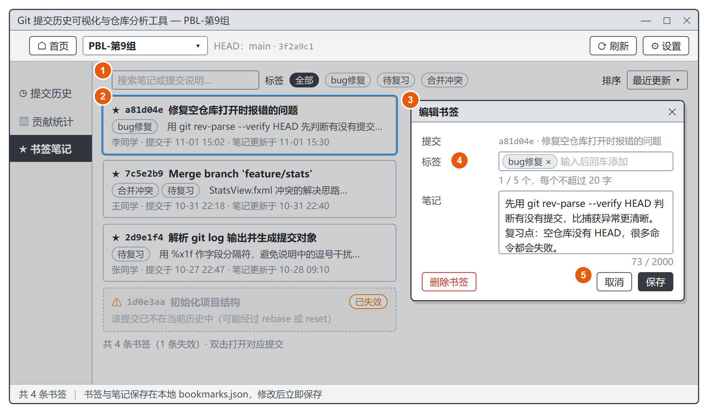

*图 6　P6 书签笔记页与 P7 书签编辑对话框原型*

**① 工具栏**：搜索框同时搜索笔记和提交说明；标签栏列出本仓库书签用到的全部标签，单击筛选；右侧可按最近更新、提交时间或创建时间排序。

**② 书签卡片**：每张卡片显示短哈希与提交标题、标签、笔记第一行（过长截断），以及作者、提交时间和笔记更新时间。双击有效的书签进入该提交的 P5；选中后按 Enter 或右键“编辑…”打开 P7。若书签指向的提交已经不在当前历史中（例如组员执行了 rebase 或 reset），卡片以灰色虚线框显示并标出“已失效”。失效书签仍然保留标题、作者和时间，因为这些信息在创建书签时已经保存了快照（见 3.4.5 节）；双击失效书签会弹出 P9 说明原因，并让用户选择保留或删除。列表底部汇总“共 4 条书签（1 条失效）”。

**③ P7 书签编辑对话框**：顶部只读显示所属提交；中间是标签和笔记；底部是操作按钮。从 P3 或 P5 为尚无书签的提交打开时为“新建”模式，没有“删除书签”按钮。

**④ 标签输入**：输入文字后按 Enter 生成一个标签，点击 × 删除；输入时会提示本仓库已有的标签，减少“bug修复”“Bug 修复”这类写法不一的情况。每个书签最多 5 个标签，每个 1～20 字，不能包含逗号和换行，不区分大小写去重。笔记最多 2000 字，右下角实时显示字数，超出时“保存”不可用。

**⑤ 操作按钮**：“保存”校验通过后立即写入 bookmarks.json 并关闭对话框；“取消”放弃修改，若已有改动则先询问是否放弃；“删除书签”需在 P9 中再次确认。P6 的状态栏注明“书签与笔记保存在本地 bookmarks.json，修改后立即保存”，让用户知道不需要手动保存。

#### 2.2.6 P2 加载进度与 P9 消息提示

图 7给出了打开仓库时的进度对话框，以及消息提示对话框的两种典型形态：错误提示和危险操作确认。

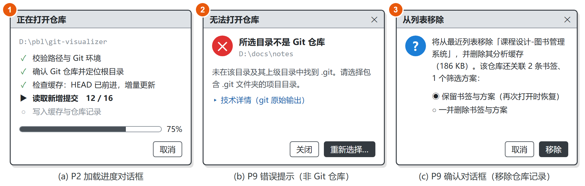

*图 7　P2 加载进度与 P9 消息提示原型*

(**a) P2 加载进度**。 对话框顶部显示正在打开的路径，中间是步骤清单：校验路径与 Git 环境、确认 Git 仓库并定位根目录、检查缓存、读取提交、写入缓存与仓库记录。已完成的步骤打勾，进行中的步骤显示实时进度（如“读取新增提交 12 / 16”，总数事先由 `git rev-list --count` 得到），未开始的步骤显示空心圆。“检查缓存”一步会写明结论（缓存命中、HEAD 已前进需增量更新、需全量构建），让用户理解为什么这次打开快或慢。整个流程在 JavaFX 的 Task 中后台运行，通过 updateProgress、updateMessage 把进度推送到界面。对话框在流程开始 300 毫秒后才显示：小型仓库缓存命中时，打开过程预计不足 300 毫秒，这样可以避免对话框一闪而过。“取消”按钮在任何时刻都可用，具体处理见 2.3.2 节。

(**b) P9 错误提示**。 由图标、标题、面向用户的说明、出错的路径、可折叠的“技术详情”（执行的 Git 命令、退出码和原始输出，可复制，便于向老师或同学求助）以及操作按钮组成。说明文字回答“发生了什么、怎么解决”，技术详情默认折叠，避免初学者被英文输出吓到。系统把可能出现的错误归为表 3中的几类，每类有固定的判定方式和提示内容。

**表 3　错误类型与提示设计**

| 错误类型 | 判定方式 | 提示内容 | 提供的操作 |
| --- | --- | --- | --- |
| 路径不存在 | Files.exists 返回 false | “路径不存在”：文件夹可能已被移动或删除 | 重新选择；最近仓库记录另有“重新定位” |
| 不是文件夹 | Files.isDirectory 返回 false | “请选择文件夹”：选中的是文件 | 重新选择 |
| 未找到 Git / 版本过低 | `git --version` 无法执行，或版本低于 2.31 | “未检测到 Git”：说明安装方法，以及可在设置中指定 git 的位置 | 打开设置、关闭 |
| 不是 Git 仓库 | `rev-parse --show-toplevel` 失败，输出含 not a git repository | “所选目录不是 Git 仓库”：该目录及其上级目录中都没有 .git | 重新选择、关闭 |
| 仓库所有者不受信任 | 输出含 dubious ownership | 解释 Git 的 safe.directory 安全机制，给出可复制的命令，由用户自行决定是否执行 | 复制命令、关闭 |
| 没有访问权限 | AccessDeniedException，或输出含 Permission denied | “没有读取该目录的权限” | 关闭 |
| 命令失败或超时 | 其他非零退出码，或单条命令超过 60 秒 | “读取提交历史失败”，附 Git 原始输出 | 重试、复制详情、关闭 |
| 本地数据文件损坏 | JSON 解析失败或字段校验不通过 | 不弹窗；状态栏提示“设置文件已损坏，已从备份恢复” | 打开数据目录 |

“仓库所有者不受信任”一类值得单独说明：当仓库文件夹的所有者不是当前用户（例如从其他电脑拷贝来的仓库）时，较新版本的 Git 会拒绝读取。解决方法是把该目录加入 safe.directory 配置，但这会修改用户的全局 Git 配置，违反“只读”原则，因此程序只给出命令和解释，不替用户执行。

(**c) P9 确认对话框**。 所有不可撤销的操作都要经过确认，默认按钮是“取消”，避免误按 Enter。图中以“从列表移除”为例：对话框写明将删除的缓存大小，并列出该仓库关联的书签和筛选方案数量，让用户选择“保留书签与方案”或“一并删除”。选择保留时，仓库记录并不真正删除，而是标记为已归档并从列表中隐藏，同时删除缓存；以后再打开同一路径时，程序按路径找到这条归档记录并恢复显示，书签和方案随之恢复。选择一并删除时，书签、方案、仓库记录和缓存全部删除。P9 的其他确认场景还有：删除书签、删除筛选方案、清除全部缓存、放弃未保存的修改、重新定位到根提交不一致的仓库。

#### 2.2.7 P8 设置与 P10 保存筛选方案

图 8是两个以表单为主的对话框：设置对话框 P8 和保存筛选方案对话框 P10。

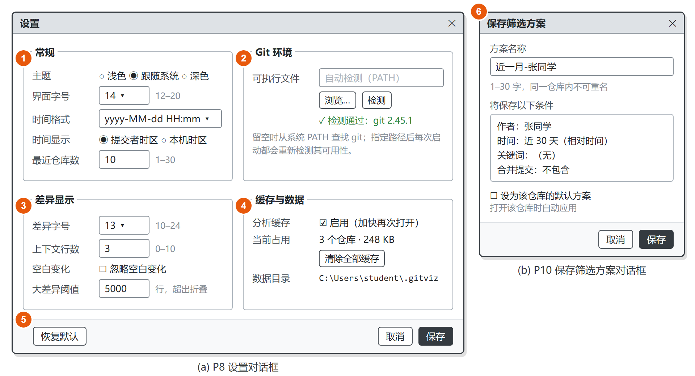

*图 8　P8 设置对话框与 P10 保存筛选方案对话框原型*

(**a) P8 设置**分为四个分组，每个输入项旁标出取值范围，取值范围与 3.4.2 节的字段约束完全一致：

**① 常规**：主题（浅色 / 跟随系统 / 深色）、界面字号（12～20）、时间格式（从预设列表中选择）、时间显示方式（提交者时区 / 本机时区）、最近仓库数（1～30）。时间显示默认采用提交者时区，因为初学者看到“15:02 (+08:00)”这样的原始时间更容易与命令行中 git log 的输出对照；小组成员分布在不同时区时，可改为本机时区统一显示。

**② Git 环境**：可执行文件路径留空时从系统 PATH 查找 git；也可以通过“浏览…”指定。“检测”按钮用指定的路径执行 `git --version`，并在下方显示结果。

**③ 差异显示**：差异字号（10～24）、默认上下文行数（0～10）、是否忽略空白变化、大差异折叠阈值（1000～50000 行）。

**④ 缓存与数据**：是否启用分析缓存、当前缓存占用（打开对话框时统计 cache 目录得到）、“清除全部缓存”按钮和数据目录位置。清除缓存需要在 P9 中确认，并且确认后立即执行，不等待点击“保存”，按钮文字也表明了这是一个立即生效的操作。

**⑤ 底部按钮**：“恢复默认”只把对话框中的各项重置为默认值，仍需点击“保存”才生效；“取消”放弃全部修改；“保存”先校验全部输入，任何一项不合法时该项红框提示且“保存”不可用，校验通过后写入 settings.json 并立即应用主题、字号等设置。

(**b) P10 保存筛选方案（⑥**）：输入方案名称（1～30 字，同一仓库内不能重名）；下方列出将要保存的条件，相对时间范围明确标注为“相对时间”，提醒用户下次应用时会以当天为基准重新计算；勾选“设为该仓库的默认方案”后，以后每次打开该仓库都自动应用这一方案。名称与已有方案重复时，输入框下方提示“已存在同名方案”，并提供“覆盖”选项；每个仓库最多保存 20 个方案，达到上限时提示先删除旧方案。已保存的方案在 P3 的方案下拉框中选择应用，每一项右侧有删除按钮。

### 2.3 交互流程与跳转逻辑

#### 2.3.1 页面跳转流程图

图 9（下页横向页面）是全部页面之间的跳转关系。图中实线框为页面，虚线框为模态对话框；单箭头表示单向跳转，双箭头表示“去了还会回来”的往返跳转；每条连线都标有编号（T01～T25）、触发条件，以及蓝色字体标出的页面间传递的数据。工作区的三个子页和 P5、P7、P10 被框在“工作区外壳”中，表示它们共享同一个工具栏、导航栏和会话对象；P8 设置从任何页面都能打开，图中只画出了从 P1 和工作区出发的两条代表性路径。每条跳转的详细说明见表 4。

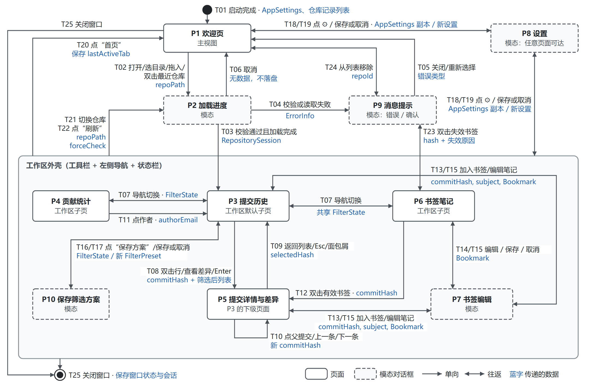

*图 9　页面跳转流程图（T01～T25 的详细说明见表 4）*

跳转设计遵循四条规则，它们也是表 4中各条“说明”的依据：

（1）**进入工作区只有一个入口**。 无论是 P1 中的哪种打开方式，还是工作区内的切换仓库与刷新，都要经过 P2 的同一套校验与加载流程（T02、T21、T22），只有加载成功才进入工作区（T03）。这样“仓库是否有效”只在一处判断，不会出现某条路径漏掉校验的情况。

（2）**对话框总是回到打开它的页面**。 P7、P8、P9、P10 关闭后回到来源页，并以返回值告诉来源页是保存还是取消，来源页据此决定是否刷新显示。

（3）**失败和取消不留下半成品**。 P2 失败或被取消时，既不进入工作区，也不修改仓库记录；若加载是从工作区发起的（切换仓库、刷新），失败后回到原工作区，原来的会话保持不变。

（4）**离开工作区时释放会话**。 返回首页或切换仓库时，当前会话占用的内存被释放，但缓存文件保留，下次打开同一仓库仍然很快。

**表 4　页面跳转明细**

| 编号 | 起点 → 终点 | 触发条件 | 传递的数据 | 说明 |
| --- | --- | --- | --- | --- |
| T01 | 启动 → P1 | 程序启动；获得单实例锁；settings.json 与 repositories.json 加载完成 | AppSettings；最近仓库记录列表（附各路径是否存在） | 若已有实例在运行（未获得锁），提示“程序已在运行”后退出 |
| T02 | P1 → P2 | 点“打开”或按 Enter；在目录选择器中确认；把文件夹拖入；双击最近仓库 | repoPath（输入的路径或记录中的路径） | 路径为空时“打开”不可用；路径失效的记录同样进入 P2，由校验报告“路径不存在” |
| T03 | P2 → P3 | 校验通过且提交数据准备完成（缓存命中、增量或全量构建完成） | RepositorySession（仓库记录、提交列表、作者、书签、方案、缓存状态） | 自动应用默认筛选方案；若记录的 lastActiveTab 为统计或书签，随即切到对应子页；空仓库也进入 P3 并显示空状态 |
| T04 | P2 → P9 | 任一校验步骤失败，或 Git 命令返回非零、超时 | ErrorInfo（错误类型、说明、建议操作、Git 原始输出） | 先关闭 P2 再显示 P9 |
| T05 | P9 → P1 | 点“关闭”或“重新选择…” | 错误类型 | 选“重新选择…”时直接弹出目录选择器；从工作区发起的加载失败时回到原工作区 |
| T06 | P2 → P1 | 点“取消”或按 Esc | 无数据（只置位取消标志） | 终止 Git 子进程、删除临时文件、不修改仓库记录；从工作区发起时回到原工作区 |
| T07 | P3 ⇄ P4 ⇄ P6 | 点击左侧导航，或 Ctrl+1/2/3 | 共享的 FilterState（P6 不使用筛选） | 不重新读取仓库；当前子页记入内存中的 lastActiveTab |
| T08 | P3 → P5 | 双击提交；选中后按 Enter；点摘要区“查看差异” | commitHash；当前筛选结果的哈希列表快照 | P5 用快照实现“上一条 / 下一条” |
| T09 | P5 → P3 | 点“返回列表”、面包屑或按 Esc | selectedHash（P5 最后显示的提交） | 恢复滚动位置并选中该提交；若它不在筛选结果中（经父提交链接跳入），只恢复滚动位置 |
| T10 | P5 → P5 | 点父提交链接；点“上一条 / 下一条”或 Alt+↑/↓ | 新的 commitHash | 首尾处对应按钮不可用；浅克隆中缺失的父提交显示为不可点击的文字 |
| T11 | P4 → P3 | 单击柱状图中的作者，或作者明细表中的一行 | authorEmail（小写邮箱） | 作者条件替换为该作者，时间等其他条件不变 |
| T12 | P6 → P5 | 双击状态为“有效”的书签 | commitHash | 该提交不在当前筛选结果中时，先清空筛选再定位，并在状态栏提示 |
| T13 | P3 / P5 → P7 | 点“编辑笔记”、右键“加入书签”或 Ctrl+D | commitHash、标题、作者、时间（用于生成快照）；已有书签时传 Bookmark | 无书签时为新建模式，有书签时为编辑模式 |
| T14 | P6 → P7 | 选中书签后按 Enter，或右键“编辑…” | Bookmark 的副本 | 编辑模式 |
| T15 | P7 → 来源页 | 点“保存”、“取消”或“删除书签”（删除需经 P9 确认） | 保存：新的 Bookmark；删除：bookmarkId；取消：无 | 保存或删除后立即写 bookmarks.json，来源页刷新 ★ 标记与卡片 |
| T16 | P3 → P10 | 点“保存方案…” | 当前 FilterState 的副本 | 当前条件为“全部”时按钮不可用 |
| T17 | P10 → P3 | 点“保存”（校验通过）或“取消” | 新的 FilterPreset；是否设为默认 | 保存后写 filter_presets.json，设为默认时同时写 repositories.json；下拉框选中新方案 |
| T18 | 任意页 → P8 | 点“设置”或 Ctrl+, | AppSettings 的深拷贝 | 对话框只修改副本，保存前不影响界面 |
| T19 | P8 → 来源页 | 点“保存”（校验通过）、“取消”或按 Esc | 保存：新的 AppSettings；取消：无 | 保存后立即写 settings.json 并应用；Git 路径变化时重新检测 |
| T20 | 工作区 → P1 | 点工具栏“首页” | lastActiveTab（写入仓库记录） | 释放会话内存，缓存文件保留 |
| T21 | 工作区 → P2 | 在仓库下拉框中选择其他仓库或“打开其他…” | repoPath | 与 T02 走同一流程，成功后替换当前会话 |
| T22 | 工作区 → P2 | 点“刷新”或按 F5 | 当前 repoPath；forceCheck = true | 重新比较 HEAD 与缓存，必要时增量或全量更新；筛选条件保留 |
| T23 | P6 → P9 | 双击状态为“已失效”的书签 | 提交哈希、失效原因 | P9 提供“保留”和“删除书签”两个选项 |
| T24 | P1 ⇄ P9 | 最近仓库右键菜单选“从列表移除…” | repoId、显示名、缓存大小、关联书签与方案数 | 按所选项归档或删除记录，见 2.2.6 节 |
| T25 | P1 / 工作区 → 结束 | 点窗口关闭按钮或 Alt+F4 | 窗口位置与尺寸、分隔条位置、lastActiveTab | 写线程处理完排队任务（最多等待 3 秒）后退出，释放单实例锁 |

#### 2.3.2 打开仓库的处理流程

T02 到 T03 / T04 之间的“打开仓库”是整个系统中逻辑最复杂、也最容易出错的流程，它同时决定了仓库是否有效、数据从哪里来以及哪些文件需要写入。图 10用活动图展开了这一流程，分为三个泳道：校验阶段、缓存判定与数据准备、读取校验与落盘。

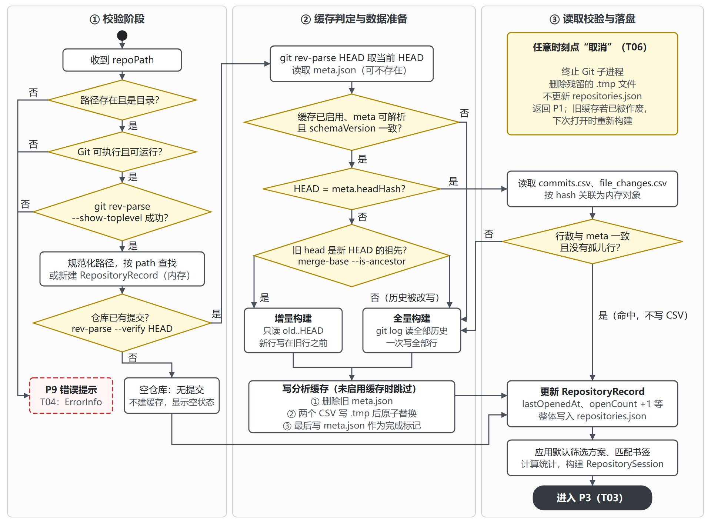

*图 10　打开仓库流程活动图（P2 期间在后台线程中执行）*

**① 校验阶段**。 收到路径后依次判断：路径是否存在且是文件夹；Git 是否可执行；`git rev-parse --show-toplevel` 是否成功（同时得到规范化的仓库根目录）。任何一步失败都转入 P9 并给出对应的错误类型（表 3），后续步骤不再执行。三项检查的顺序是由“代价从低到高、原因从简单到复杂”决定的：先做不需要启动子进程的文件系统检查，再启动 Git；先排除环境问题，再判断目录本身。这样报告给用户的总是最根本的那个原因，例如没装 Git 时不会误报成“不是 Git 仓库”。

校验通过后，程序用规范化路径在仓库记录中查找：找到则复用（若是已归档的记录，同时取消归档），找不到则在内存中新建一条记录（生成新的 repoId），但此时还不写盘。接着用 `git rev-parse --verify HEAD` 判断仓库是否已有提交：新建的空仓库没有 HEAD，许多 Git 命令都会失败，所以这里直接走空仓库分支，不建缓存，在 P3 中显示空状态。

**② 缓存判定与数据准备**。 取得当前 HEAD 后读取该仓库缓存目录中的 meta.json（可能不存在），然后逐级判断：

- 缓存未启用、meta.json 不存在或无法解析、格式版本与程序不一致时，不能信任已有缓存，直接**全量构建**。
- HEAD 与 meta 中记录的 headHash 相同，说明自上次构建以来没有新提交，进入第三泳道读取缓存，称为**缓存命中**。
- HEAD 不同时，用 `git merge-base --is-ancestor 旧head 新HEAD` 判断旧 head 是否是新 HEAD 的祖先。是，说明历史只是向前增加了提交，做**增量构建**；否，说明历史被改写过（rebase、reset 或切换到了另一条分支），旧缓存中可能包含已不在当前历史中的提交，只能**全量构建**。

增量构建的正确性可以这样推导：设 R(x) 为从提交 x 出发能到达的全部提交。当旧 head 是新 HEAD 的祖先时，R(旧head) ⊆ R(新HEAD)；而 Git 的 `旧head..新HEAD` 恰好表示 R(新HEAD) − R(旧head)。因此“旧缓存中的提交 ∪ 本次读到的提交”正好等于 R(新HEAD)，不多也不少。反之，若旧 head 不是祖先，旧缓存中就可能存在不属于 R(新HEAD) 的提交，增量结果会出错，这就是第二种情况必须全量构建的原因。

构建结果写入缓存时，三个文件的写入顺序是刻意安排的：先删除旧的 meta.json，再把两个 CSV 写到临时文件并原子替换，最后写入新的 meta.json。meta.json 因此相当于“缓存完整”的标记：如果写到一半程序崩溃或被取消，下次打开时找不到 meta.json，就会按“无缓存”处理并重新构建，永远不会读到“新 CSV + 旧 meta”或“半个 CSV”这样不一致的组合。未启用缓存时跳过写缓存这一步，构建结果只保存在内存中。

**③ 读取校验与落盘**。 缓存命中时流式读取两个 CSV，按哈希把文件变更关联到提交上（关联算法见 3.3.3 节），并核对行数与 meta 中的记录是否一致、是否存在找不到所属提交的“孤儿行”。核对失败说明缓存被手工改动或损坏，转为全量构建。数据准备好后，更新仓库记录的最近打开时间、打开次数和提交数，整体写入 repositories.json；最后应用默认筛选方案、把书签与提交匹配、计算统计，构建 RepositorySession，进入 P3。仓库记录放在最后才写，是为了保证只有“成功打开过”的仓库才会出现在最近列表中。

**取消（T06**）。 用户可以在任何时刻点击取消：后台任务检查取消标志并终止正在运行的 Git 子进程，删除残留的临时文件，不写 repositories.json，然后回到 P1。如果取消发生在“已删除旧 meta.json、新 meta 尚未写入”的时间窗内，旧缓存已经作废，下次打开时会重新构建。这比试图恢复旧缓存更简单，且结果总是正确的。

#### 2.3.3 页面间的数据传递机制

表 4中“传递的数据”一列在实现上分为四种机制，选择哪一种取决于数据的生命周期和是否允许被修改：

- **会话对象 RepositorySession**。 每打开一个仓库创建一个，包含仓库记录、不可变的提交列表、按哈希建立的索引、作者汇总、书签列表、筛选方案和缓存状态。它在 P2 的后台任务中构建完成，通过 Platform.runLater 交给工作区（T03），工作区再把同一个对象交给三个子页。提交数据只有这一份，子页之间切换（T07）时不需要传递或复制任何东西。
- **可观察的筛选状态 FilterState**。 作者集合、时间范围、关键词、是否包含合并提交都是 JavaFX 的可观察属性。P3 修改它，P3 的列表和 P4 的图表都监听它的变化并自动刷新，这就是“两页共享筛选条件”的实现方式。P4 跳回 P3（T11）时，只需修改 FilterState 的作者条件再切换页面，不需要额外传参。
- **对话框的副本与返回值**。 P7、P8、P10 打开时接收数据的副本，用户的修改只作用于副本；对话框通过 showAndWait() 返回 Optional 结果，“保存”返回新对象，“取消”返回空值。调用方拿到结果后再决定是否更新会话并持久化。好处是“取消”不需要任何回滚逻辑，丢弃副本即可。
- **列表快照**。 进入 P5 时（T08）除了提交哈希，还传入当前筛选结果的哈希列表快照。即使用户之后修改了筛选条件，P5 中“上一条 / 下一条”的顺序也保持稳定，不会出现“当前提交突然不在列表中”的情况。

线程方面，后台线程只产生不可变的结果对象，所有界面对象和可观察属性只在 JavaFX 应用线程中读写；持久化时，由应用线程把对象序列化成字符串快照后交给写线程（见 3.6 节）。这样数据在线程之间传递时不会出现并发修改的问题。

#### 2.3.4 系统整体操作流程

开题文档描述的业务流程为：启动程序 → 选择目录 → 校验仓库 → 读取提交历史 → 展示时间线与统计 → 选择提交查看差异 → 切换筛选条件或结束。下面结合页面与跳转编号，按四个典型场景说明用户的完整操作过程，前两个场景覆盖了上述业务流程的全部步骤。

**场景一：首次使用，分析小组的课程项目仓库**。

（1）启动程序，进入 P1（T01）。右上角显示“Git 2.45.1 已就绪”，最近仓库列表为空。

（2）把项目文件夹拖入打开区（T02）。P2 依次校验路径、Git 环境和仓库根目录；由于没有缓存，执行全量构建，进度条显示读取进度。

（3）加载完成，进入 P3（T03），看到按时间倒序排列的 58 条提交。

（4）在筛选栏选择“近 30 天”，列表即时更新为 42 条；再点左侧“贡献统计”（T07），P4 显示同一范围内的作者柱状图和时间分布折线图。

（5）在柱状图中单击“李同学”（T11），回到 P3 并只显示李同学的提交；双击“修复空仓库打开时报错的问题”进入 P5（T08），查看 GitService.java 的差异。

（6）按 Ctrl+D 打开 P7（T13），加上标签“bug修复”并写下笔记，保存后立即写入 bookmarks.json（T15）。

（7）按 Esc 返回列表（T09），点“重置”恢复全部提交；需要时点“保存方案…”把常用条件保存下来（T16、T17）。

（8）关闭窗口（T25），程序保存窗口状态与当前子页后退出。

**场景二：一周后再次打开同一仓库**。 在 P1 双击“PBL-第9组”（T02）。期间组员新推送了 16 次提交，P2 判断旧 head 是新 HEAD 的祖先，只读取新增的 16 次提交并更新缓存，数秒内进入 P3；若没有新提交，缓存直接命中，整个过程预计不到 300 毫秒，P2 甚至不会出现。若上次离开时停在统计页，这次会直接进入 P4；若设置了默认方案，会自动应用。在 P6 中可以看到之前的书签；若某条书签对应的提交被组员 rebase 掉了，它会显示为“已失效”，但笔记内容仍然保留。

**场景三：选错了目录**。 用户误选了存放文档的文件夹，P2 在第三步发现它不是 Git 仓库，关闭后显示 P9（T04），说明“该目录及其上级目录中都没有 .git”。用户点“重新选择…”（T05），直接弹出目录选择器，选对后继续 T02。程序在整个过程中没有写入任何文件，也没有在最近列表中留下无效记录。

**场景四：维护最近仓库列表**。 课程结束后，用户在 P1 右键旧仓库选择“从列表移除…”（T24），在 P9 中选择“保留书签与方案”，记录被归档、缓存被删除，释放了磁盘空间；以后若再次打开该仓库，书签与方案会自动恢复。

#### 2.3.5 快捷键

为了让熟练用户可以不依赖鼠标完成主要操作，系统提供表 5中的快捷键。所有快捷键都在对应按钮的悬停提示中注明，状态栏也会提示当前页面最常用的几个。

**表 5　快捷键一览**

| 快捷键 | 适用页面 | 作用 |
| --- | --- | --- |
| Ctrl+O | P1、工作区 | 打开目录选择器，选择要打开的仓库 |
| Enter | P1 路径框、P3 列表、P6、对话框 | 打开所输入的路径；进入所选提交的 P5；编辑所选书签；触发对话框的默认按钮 |
| Esc | P5、所有对话框 | 返回提交列表；取消并关闭对话框（P2 中等同于“取消”） |
| Ctrl+F | P3、P6 | 把光标移到搜索框 |
| Ctrl+1 / 2 / 3 | 工作区 | 切换到提交历史 / 贡献统计 / 书签笔记 |
| Ctrl+D | P3、P5 | 为当前提交加入或编辑书签 |
| F5 | 工作区 | 刷新（重新检查 HEAD 与缓存） |
| Alt+↑ / Alt+↓ | P5 | 上一条 / 下一条提交 |
| Ctrl+, | 任意页面 | 打开设置 |

## 三、数据持久化设计

### 3.1 持久化范围：哪些数据需要保存

按课程约束，所有需要长期保存的数据都存放在本地文件中。设计的第一步不是选格式，而是判断哪些数据真正需要保存。本项目用两个问题来判断：**这份数据丢失后能否恢复？恢复的代价有多大**？ 据此可以把系统中的数据分为三类，三类采取完全不同的策略：

- **不可恢复的用户数据**：设置、仓库记录、筛选方案、书签与笔记都由用户操作产生，Git 仓库中没有对应的信息，丢失后无法找回。它们必须可靠地保存，宁可多花一点写入时间，也要保证不损坏、不丢失。
- **可以重建、但重建较慢的数据**：提交元数据和文件变更可以由 `git log` 重新生成。小型仓库读取很快，但有上万次提交的仓库，每次打开都解析全部历史会让用户等待较长时间。这类数据作为缓存保存，它的可靠性要求低于用户数据，出现任何异常都可以直接丢弃重建。
- **可以快速得到的数据**：统计结果、作者列表可以在内存中由提交数据算出，差异文本可以用 `git show` 按需读取。这类数据不写入文件，因为保存它们除了增加“保存的结果与实际不一致”的风险外，没有其他作用。

按上述标准对系统中的每类数据逐一判断，结果见表 6。

**表 6　数据的持久化范围**

| 数据 | 是否保存 | 存放位置 | 判断理由 |
| --- | --- | --- | --- |
| 应用设置、窗口状态 | 是 | settings.json | 用户偏好，无法从其他地方恢复；丢失后虽可重新设置，但每次启动都重设无法接受 |
| 最近仓库记录 | 是 | repositories.json | 是最近列表和仓库级偏好（显示名、置顶、默认方案）的来源，也是书签与方案挂靠的主体 |
| 筛选方案 | 是 | filter_presets.json | 用户命名和创建的数据，无法从仓库恢复 |
| 书签与笔记 | 是 | bookmarks.json | 用户亲自写下的内容，是系统中最不能丢失的数据 |
| 提交元数据、文件变更 | 是（缓存） | cache/{repoId}/\*.csv | 可由 Git 重建，但大仓库重建耗时；保存后再次打开只需增量更新 |
| 统计结果 | 否 | 内存 | 一次遍历即可算出（O(n)），且随筛选条件变化，保存没有意义 |
| 作者列表 | 否 | 内存 | 由提交数据聚合得到；单独保存会造成冗余，还要处理不一致的问题 |
| 差异文本 | 否 | 内存（LRU，约 20 份） | 体积可能很大；`git show` 按需读取足够快；不写盘也避免在仓库之外多留一份用户源代码 |
| 提交说明完整正文 | 否 | 内存（LRU） | 列表只需标题行；正文只在查看某个提交时才需要，可按需读取 |
| 当前筛选条件 | 否 | 内存（FilterState） | 每次打开都从“全部”或默认方案开始，避免用户以为提交“丢失”；需要复用时可保存为方案 |

这样划分之后，整个持久化设计可以概括为两句话：**用户数据用 JSON 可靠保存，分析缓存用 CSV 高效保存**。后文 3.5 节会进一步说明这一选型的理由。

### 3.2 存储位置与目录结构

所有数据集中保存在当前用户主目录下的 `.gitviz` 文件夹中（Windows 上例如 C:\Users\student\\.gitviz），程序通过 `System.getProperty("user.home")` 取得主目录，首次启动时自动创建。不选择其他位置的原因如下：不写入被分析的仓库，是因为“只读”原则要求程序不改变仓库的任何内容，否则 `git status` 中会多出未跟踪的文件；不写入程序安装目录，是因为该目录可能没有写权限，而且升级或重新解压程序时数据容易丢失。目录中的内容如表 7所示。

**表 7　数据目录结构（路径相对于 ~/.gitviz）**

| 路径 | 类别 | 内容与说明 |
| --- | --- | --- |
| settings.json | 用户数据 | 全局设置与窗口状态，全局一份 |
| repositories.json | 用户数据 | 所有仓库记录（含已归档的记录） |
| filter_presets.json | 用户数据 | 所有仓库的筛选方案，以 repoId 区分 |
| bookmarks.json | 用户数据 | 所有仓库的书签与笔记，以 repoId 区分 |
| \*.json.bak | 备份 | 每个 JSON 文件的上一个版本，写入新内容前生成，用于损坏时恢复 |
| \*.json.corrupt-\<时间戳> | 隔离 | 解析失败的文件改名后保留，供用户手工找回内容，程序不再读取 |
| \*.tmp | 临时 | 原子写入过程中的临时文件，正常情况下很快消失；启动时清理残留 |
| app.lock | 锁文件 | 通过 FileLock 保证只有一个程序实例，内容为空 |
| cache/{repoId}/meta.json | 缓存 | 缓存的元信息，既是有效性判定依据，也是“缓存完整”的标记 |
| cache/{repoId}/commits.csv | 缓存 | 该仓库的提交元数据，每次提交一行 |
| cache/{repoId}/file_changes.csv | 缓存 | 该仓库的文件变更，每次提交的每个文件一行 |
| logs/gitviz-yyyy-MM-dd.log | 日志 | 运行日志，按天一个文件，保留 7 天，不属于业务数据 |

缓存目录使用 repoId（UUID）而不是仓库路径或仓库名来命名，有三点考虑：第一，仓库文件夹可能被移动，用 UUID 命名时只需更新记录中的路径，缓存可以继续使用，无须重命名目录；第二，路径中含有冒号、反斜杠等不能出现在文件夹名中的字符，转义后可读性也很差；第三，把长路径拼入文件夹名容易超过 Windows 传统的 260 字符路径长度限制，而 UUID 长度固定。用户想知道某个缓存目录属于哪个仓库时，可以在 repositories.json 中按 repoId 查到。

### 3.3 数据模型与关联设计

#### 3.3.1 实体类图

需要持久化的实体及其关系如图 11（下页横向页面）所示。图中蓝色表头的类保存在 JSON 文件中，橙色表头的类属于分析缓存；粗体字段是主键，红色字段是外键或引用；连线两端的红色文字是多重性；虚线表示不强制一致的逻辑引用。类名后的括号注明了对应的文件。

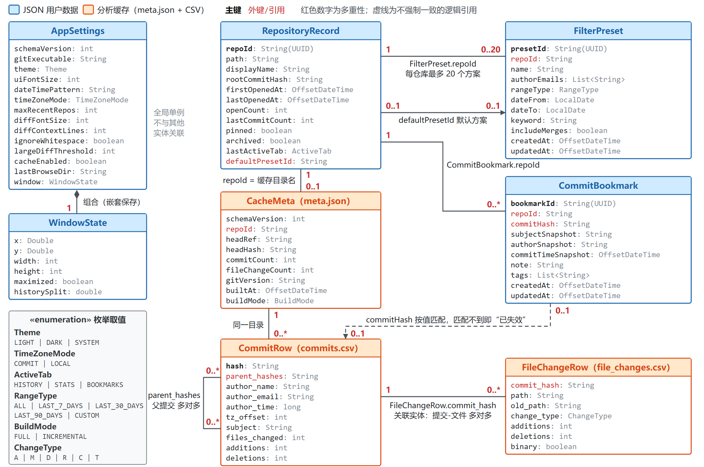

*图 11　持久化实体 UML 类图*

各实体的职责如下：

- **AppSettings / WindowState**：全局设置，整个程序只有一份，不属于任何仓库，因此与其他实体没有关联。WindowState 是 AppSettings 的组成部分，嵌套保存。
- **RepositoryRecord**：用户打开过的一个本地仓库，是用户数据的中心实体，方案、书签和缓存都通过 repoId 挂靠在它之下。
- **FilterPreset**：某个仓库下一组命名保存的筛选条件。
- **CommitBookmark**：用户对某个仓库中某次提交的标记，包含标签和笔记，并保存提交信息的快照。
- **CacheMeta**：一个仓库缓存的元信息，说明缓存对应哪个 HEAD、包含多少行，以及是怎样构建的。
- **CommitRow / FileChangeRow**：提交和文件变更的缓存行，对应 CSV 文件中的一行。

**为什么 Author、Tag、统计结果不是实体**。 判断一个概念是否要成为独立的持久化实体，要看它有没有自己的、无法从其他数据得到的属性。作者的所有信息都来自提交记录，由小写邮箱聚合得到，用户也不能编辑作者，因此不需要作者文件；标签只有“名字”这一个属性，没有颜色、说明等其他信息，直接以字符串数组内嵌在书签中，P6 的标签栏遍历本仓库书签即可得到；统计结果可以随时重算，理由已在 3.1 节说明。文件路径同样没有独立的属性，也不单独成为实体。

**主键的选择**。 仓库、方案、书签使用随机生成的 UUID 作为主键，因为它们没有稳定的自然键：路径可能因为移动文件夹而变化；根提交哈希也不合适，同一个项目在两个位置的克隆具有相同的根提交，却应该是两条记录，而且空仓库根本没有根提交；方案名和书签内容都可以被用户修改。提交则直接使用哈希作为主键，因为哈希由提交内容计算得出，本身就是全局稳定的标识，再生成一个 ID 只会增加一次转换。

**为什么按实体类型分文件，而不是按仓库分文件或全部放在一起**。 把四类用户数据都放进一个大文件，修改任何一项都要重写全部内容，而且一处损坏会影响所有数据。分为四个文件后，它们的写入频率和重要程度可以分开对待：设置很少变化，书签则经常被编辑；书签文件出现问题时，设置和仓库列表不受影响。之所以没有进一步按仓库拆分书签和方案，是因为它们的总量很小（预计最多几百条），全局一个文件在启动时一次读入即可，实现最简单。缓存的情况正好相反：它体积大、只在打开特定仓库时才需要，还要能按仓库整体删除，所以按仓库分目录存放。

**有意保留的冗余**。 模型基本遵循“同一事实只保存一处”的原则，但有两处例外，都是经过权衡后的选择。一是书签中的三个快照字段（标题、作者、时间），它们与提交记录重复，但提交被 rebase 后就无处可查，快照是失效书签仍能显示有用信息的唯一依据；快照在创建时写入，以后不再更新，所以不存在“两边不一致”的问题。二是仓库记录中的 lastCommitCount，它只用于 P1 显示“58 次提交”：如果要从缓存中取得这个数字，就得在启动时读取每个仓库的 meta.json，而且关闭缓存后就没有数据可用。

#### 3.3.2 关系类型与设计理由

表 8列出了模型中的全部关系及其实现方式。其中多对多关系没有一律拆分成“中间文件”，而是根据关联本身是否带有属性来决定：提交与文件之间的关联带有变更类型、增删行数等属性，必须成为独立的关联实体（FileChangeRow）；书签与标签、方案与作者之间的关联没有额外属性，内嵌数组就足够了。

**表 8　实体关系与设计理由**

| 关系 | 类型 | 多重性 | 实现方式 | 设计理由 |
| --- | --- | --- | --- | --- |
| AppSettings — WindowState | 一对一（组合） | 1 : 1 | 嵌套在 settings.json 的 window 字段中 | 窗口状态离开设置没有意义，也不被其他实体引用，没有必要单独成文件 |
| RepositoryRecord — FilterPreset | 一对多 | 1 : 0..20 | FilterPreset.repoId | 方案中的作者和日期只对特定仓库有意义，因此方案属于仓库；限制 20 个以保持下拉框可用 |
| RepositoryRecord — FilterPreset（默认方案） | 一对一（可选） | 0..1 : 0..1 | RepositoryRecord.defaultPresetId | 字段放在仓库一侧，从结构上保证一个仓库最多一个默认方案；若在方案上加 isDefault 标记，则要额外保证同一仓库只有一个 true |
| RepositoryRecord — CommitBookmark | 一对多 | 1 : 0..\* | CommitBookmark.repoId | 同一哈希可能出现在多个克隆中，用户在不同仓库的笔记应当相互独立，所以必须用 repoId 区分 |
| RepositoryRecord — CacheMeta | 一对一（可选） | 1 : 0..1 | 目录名 = repoId，且 meta.json 中的 repoId 与之一致 | 缓存可以被关闭或清除，所以是可选的；仓库记录不依赖缓存，缓存却依赖记录 |
| CacheMeta — CommitRow | 一对多 | 1 : 0..\* | 位于同一目录；commitCount 校验行数 | 目录本身表达了归属，CSV 行中无须重复 repoId，每行可以节省 37 个字符 |
| CommitRow — FileChangeRow | 一对多 | 1 : 0..\* | FileChangeRow.commit_hash | 一次提交修改多个文件；空提交没有变更行 |
| 提交 — 文件路径 | 多对多 | M : N | 以 FileChangeRow 作为关联实体 | 一次提交改多个文件，一个文件被多次提交修改；关联带有 change_type、增删行等属性，无法用数组表达 |
| CommitRow 自关联（父子） | 多对多 | 0..\* : 0..\* | parent_hashes（空格分隔） | 合并提交有多个父提交，分叉点有多个子提交；读取时只需由子找父，所以不必拆成单独的文件 |
| CommitBookmark ⇢ CommitRow | 逻辑引用 | 0..1 : 0..1 | commitHash 按值匹配，不要求一定匹配到 | 书签的寿命比提交记录长：历史可能被改写、缓存可能被清除，引用失效是正常情况而不是错误 |
| CommitBookmark — 标签 | 多对多 | M : N | 内嵌 tags 数组 | 标签只有名字一个属性，独立成文件只会增加同步负担；重命名标签等操作目前也不在范围内 |
| FilterPreset — 作者 | 多对多 | M : N | 内嵌 authorEmails 数组 | 作者不是持久化实体，方案中保存匹配依据（邮箱）即可 |

#### 3.3.3 文件间的关联与读取时的匹配

数据被拆分为多个文件后，文件之间没有数据库的外键约束和连接查询，这些都要由程序完成。图 12标出了每个文件的主键（PK）、唯一字段（UK）和外键（FK），以及文件间的八处关联。其中实线是读取时严格校验的关联，长虚线是允许匹配不到的逻辑引用，短虚线是数量校验。

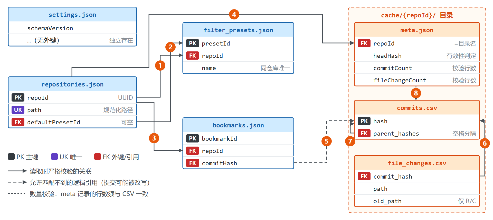

*图 12　持久化文件之间的关联关系*

八处关联的含义如下：

- **① FilterPreset.repoId → RepositoryRecord.repoId**：方案属于哪个仓库。
- **② RepositoryRecord.defaultPresetId → FilterPreset.presetId**：该仓库的默认方案，可以为空。
- **③ CommitBookmark.repoId → RepositoryRecord.repoId**：书签属于哪个仓库。
- **④ RepositoryRecord.repoId → 缓存目录名与 meta.json 的 repoId**：通过目录名定位缓存，再用文件内的 repoId 二次确认，防止目录被手工复制后张冠李戴。
- **⑤ CommitBookmark.commitHash ⇢ commits.csv 的 hash**：匹配到就是有效书签，匹配不到就是失效书签。
- **⑥ file_changes.csv 的 commit_hash → commits.csv 的 hash**：文件变更属于哪次提交。
- **⑦ commits.csv 的 parent_hashes → commits.csv 的 hash**：同一文件内的自引用，表示父提交。
- **⑧ meta.json 的 commitCount、fileChangeCount ↔ 两个 CSV 的数据行数**：数量校验，用于发现被截断或手工改动过的缓存。

读取时的匹配分为两个阶段：程序启动时完成用户数据之间的匹配（①②③），打开仓库时再完成缓存相关的匹配（④⑤⑥⑦⑧）。具体步骤如下：

（1）**建立仓库索引**。 读入 repositories.json，建立两个 HashMap：按 repoId 索引（供方案、书签查找所属仓库），按路径比较键索引（供打开仓库时查找记录。路径比较键是规范化后的路径，Windows 下再转成小写，因为 Windows 路径不区分大小写）。

（2）**分组方案和书签**。 读入 filter_presets.json 和 bookmarks.json，分别遍历，按 repoId 放入 `Map<repoId, List>`。如果某条数据的 repoId 在索引中找不到（孤儿数据），不删除也不显示，只写入日志。正常操作不会产生孤儿（原因见 3.7 节），它只可能来自手工编辑 repositories.json。此时保留数据，可以让用户在改回文件后找回笔记。

（3）**解析默认方案**。 对每条仓库记录，在该仓库的方案分组中查找 defaultPresetId。找不到或方案属于其他仓库时，把它修复为 null，等下次保存 repositories.json 时写回文件。

（4）**载入提交**。 打开仓库时确认 meta.json 中的 repoId 与目录名一致，然后流式读取 commits.csv，以 hash 为键放入 LinkedHashMap，并核对行数。

（5）**关联文件变更**。 流式读取 file_changes.csv，对每一行用 commit_hash 在 LinkedHashMap 中查找，把变更追加到该提交的列表中。如果某一行找不到所属的提交（孤儿行），或者总行数与 meta 不符，说明缓存已不可信，放弃本次读取，转为全量构建。这里的处理与第 2 步不同：缓存可以从 Git 重建，直接丢弃是最简单且一定正确的做法；用户数据不可重建，所以要尽量保留。

（6）**解析父提交**。 把 parent_hashes 按空格拆开，逐个在 LinkedHashMap 中查找。找到时，P5 的父提交显示为可点击的链接；找不到（常见于浅克隆，父提交不在本地）时只显示文字，不算错误。

（7）**匹配书签**。 遍历本仓库的书签，用 commitHash 在提交表中查找，找到时状态为 VALID，否则为 DANGLING（失效）。这一状态只存在于内存，不写入文件，因为它随当前历史变化。同时生成已加书签的哈希集合 `Set<String>`，P3 绘制每一行时用它判断是否显示 ★。这一步使用的是内存中的提交表，所以即使关闭了缓存（提交表直接来自 `git log`），也能正常工作。

（8）**汇总作者**。 遍历提交，按小写邮箱聚合，显示名取该邮箱最新一次提交使用的名字。结果用于 P3 的作者下拉框和 P4 的统计。

**复杂度分析**。 设提交数为 C，文件变更数为 F，书签数为 B，方案数为 P。由于每次查找都使用 HashMap，平均耗时为常数，整个匹配过程的时间复杂度为 O(C + F + B + P)。如果对每条文件变更都去提交列表中顺序查找，复杂度将达到 O(C × F)：以 1 万次提交、4 万条文件变更计算，最坏需要比较 4 亿次；而使用 HashMap 只需约 4 万次查找。这也是“一次读入内存、建立索引后再匹配”这一方案的依据：既然筛选、统计和界面显示都需要全部提交，就没有必要像数据库那样按需查询。

### 3.4 持久化文件设计详表

#### 3.4.1 通用约定

各字段表中的约定如下，后面不再逐一重复：

- **是否必填**：“是”表示键必须存在且值不能为 null，CSV 中单元格不能为空，但列表字段允许空数组；“否”表示可以为 null 或空；“条件”表示满足说明中的条件时必填。
- **编码**：所有文件均为 UTF-8。JSON 文件无 BOM；CSV 文件带 BOM，换行符为 CRLF，转义规则遵循 RFC 4180。
- **时间**：带时区的时间戳保存为 ISO-8601 格式（如 2026-11-01T21:52:18+08:00），日期保存为 yyyy-MM-dd。
- **枚举**：保存枚举常量的名称，遇到未知取值时回退到默认值。枚举取值已列在图 11左下角。
- **标识**：UUID 为 UUID.randomUUID() 生成的 36 位小写字符串，创建后不再改变。提交哈希为小写十六进制字符串，长度见各表。
- **长度**：按字符数计算，一个汉字算一个字符。

所有约束都在两处检查：一是界面保存时，不符合约束的输入不能保存；二是加载文件时，因为文件可能被手工修改或损坏。加载时发现问题，程序不会因此崩溃，而是按 3.7 节的规则修复或隔离。

#### 3.4.2 settings.json：应用设置

settings.json 保存全局设置，对应 AppSettings（表 9）和其中嵌套的 WindowState（表 10）。每个字段都有默认值，因此文件不存在时（首次启动）程序仍可以正常运行，并在第一次保存时创建文件。各字段的取值范围与设置页 P8 上的提示一致。

**表 9　AppSettings 字段设计**

| 字段名 | 含义 | 数据类型 | 是否必填 | 约束说明 |
| --- | --- | --- | --- | --- |
| `schemaVersion` | 文件格式版本 | int | 是 | 当前固定为 1；升级规则见 3.5 节 |
| `gitExecutable` | git 程序路径 | String | 否 | null 表示从 PATH 查找；非空时须指向可执行文件，长度 ≤ 1024 |
| `theme` | 界面主题 | Theme | 是 | LIGHT / DARK / SYSTEM，默认 SYSTEM |
| `uiFontSize` | 界面字号 | int | 是 | 12～20，默认 14 |
| `dateTimePattern` | 时间显示格式 | String | 是 | 必须是预设列表中的值，默认 yyyy-MM-dd HH:mm。不允许自由输入，因为非法格式会使时间格式化抛出异常 |
| `timeZoneMode` | 时间显示方式 | TimeZoneMode | 是 | COMMIT（提交者时区）/ LOCAL（本机时区），默认 COMMIT |
| `maxRecentRepos` | 最近仓库数上限 | int | 是 | 1～30，默认 10；置顶的记录不计入 |
| `diffFontSize` | 差异区字号 | int | 是 | 10～24，默认 13 |
| `diffContextLines` | 默认上下文行数 | int | 是 | 0～10，默认 3 |
| `ignoreWhitespace` | 默认忽略空白 | boolean | 是 | 默认 false |
| `largeDiffThreshold` | 大差异折叠阈值 | int | 是 | 1000～50000（行），默认 5000 |
| `cacheEnabled` | 是否启用缓存 | boolean | 是 | 默认 true；关闭后不读写缓存，已有缓存文件保留 |
| `lastBrowseDir` | 上次浏览的目录 | String | 否 | 长度 ≤ 1024；目录不存在时回退到用户主目录 |
| `window` | 窗口状态 | WindowState | 是 | 嵌套对象，见表 10；缺失时使用默认值 |

**表 10　WindowState 字段设计**

| 字段名 | 含义 | 数据类型 | 是否必填 | 约束说明 |
| --- | --- | --- | --- | --- |
| `x`、`y` | 窗口左上角坐标 | Double | 否 | null 表示居中；加载时若窗口不在任何屏幕范围内（如外接显示器已拔除），也按居中处理 |
| `width` | 窗口宽度 | int | 是 | ≥ 960，默认 1280 |
| `height` | 窗口高度 | int | 是 | ≥ 640，默认 800 |
| `maximized` | 是否最大化 | boolean | 是 | 默认 false |
| `historySplit` | P3 列表与摘要的分隔比例 | double | 是 | 0.3～0.8，默认 0.65 |

示例文件：

```json
{
  "schemaVersion": 1,
  "gitExecutable": null,
  "theme": "SYSTEM",
  "uiFontSize": 14,
  "dateTimePattern": "yyyy-MM-dd HH:mm",
  "timeZoneMode": "COMMIT",
  "maxRecentRepos": 10,
  "diffFontSize": 13,
  "diffContextLines": 3,
  "ignoreWhitespace": false,
  "largeDiffThreshold": 5000,
  "cacheEnabled": true,
  "lastBrowseDir": "D:\\pbl",
  "window": {
    "x": 160.0,
    "y": 90.0,
    "width": 1280,
    "height": 800,
    "maximized": false,
    "historySplit": 0.65
  }
}
```

#### 3.4.3 repositories.json：仓库记录

文件顶层是一个对象，包含 schemaVersion 和 repositories 数组，数组的每个元素对应一条 RepositoryRecord（表 11）。

**表 11　RepositoryRecord 字段设计**

| 字段名 | 含义 | 数据类型 | 是否必填 | 约束说明 |
| --- | --- | --- | --- | --- |
| `repoId` | 仓库标识（主键） | String（UUID） | 是 | 全局唯一，36 位，创建后不变 |
| `path` | 仓库根目录 | String | 是 | 规范化的绝对路径，全局唯一（Windows 下不区分大小写），长度 ≤ 1024 |
| `displayName` | 显示名称 | String | 是 | 1～50 字，默认取文件夹名，可以重名 |
| `rootCommitHash` | 根提交哈希 | String | 条件 | 仓库有提交时必填，空仓库为 null；40 位（SHA-1 仓库）或 64 位（SHA-256 仓库）小写十六进制 |
| `firstOpenedAt` | 首次打开时间 | OffsetDateTime | 是 | 首次打开成功时写入，以后不变 |
| `lastOpenedAt` | 最近打开时间 | OffsetDateTime | 是 | 不早于 firstOpenedAt |
| `openCount` | 打开次数 | int | 是 | ≥ 1 |
| `lastCommitCount` | 上次打开时的提交数 | int | 是 | ≥ 0；只用于 P1 显示，不参与任何判断 |
| `pinned` | 是否置顶 | boolean | 是 | 默认 false |
| `archived` | 是否归档 | boolean | 是 | 默认 false；为 true 时不显示在最近列表中，但关联的书签和方案仍保留 |
| `lastActiveTab` | 上次停留的子页 | ActiveTab | 是 | HISTORY / STATS / BOOKMARKS，默认 HISTORY |
| `defaultPresetId` | 默认筛选方案 | String（UUID） | 否 | 必须指向 repoId 相同的 FilterPreset，否则修复为 null |

几个字段的设计思路说明如下。`path` 使用 Path.toRealPath() 规范化后保存，这样同一个仓库不论是通过子目录、符号链接还是大小写不同的路径打开，都对应同一条记录。`rootCommitHash` 用于“重新定位”时判断新位置是否为同一仓库，它不需要额外的 Git 命令，直接取提交数据中没有父提交的最早一条即可；有多个根提交时也取最早的一条。根提交几乎不会改变，所以它比 HEAD 更适合作为判断依据（但如果全部历史都被改写，它也会变化，此时 P9 会提醒用户，由用户决定是否继续）。

`archived` 用来支持 2.2.6 节的“保留书签与方案”：记录不能真正删除，否则关联的书签和方案就成了孤儿，所以只是打上标记，同时删除可重建的缓存以释放空间。未置顶的记录超过 `maxRecentRepos` 时，最久未打开的记录也按同样的方式归档。之后再次打开相同路径时，程序在 3.3.3 节第 1 步建立的路径索引中找到这条记录，把 archived 改回 false，书签和方案随之恢复。归档记录本身很小（约 400 字节），即使累积几百条，也不影响加载速度。

示例文件（第一条对应原型图中的示例仓库，第二条对应 P9 确认对话框中的仓库）：

```json
{
  "schemaVersion": 1,
  "repositories": [
    {
      "repoId": "3c9e5d1a-7f42-4b8e-9a61-2d5f0c7e8b14",
      "path": "D:\\pbl\\git-visualizer",
      "displayName": "PBL-第9组",
      "rootCommitHash": "5d17b0e3a9c2f4e68b1d7a0c3e5f92b4d6a8c1e7",
      "firstOpenedAt": "2026-10-08T19:20:11+08:00",
      "lastOpenedAt": "2026-11-01T21:52:18+08:00",
      "openCount": 23,
      "lastCommitCount": 58,
      "pinned": true,
      "archived": false,
      "lastActiveTab": "HISTORY",
      "defaultPresetId": null
    },
    {
      "repoId": "8f1b6c2e-4d3a-4f9b-b7e5-0a6c9d2e1f38",
      "path": "D:\\code\\library-system",
      "displayName": "课程设计-图书管理系统",
      "rootCommitHash": "c7e20a94f1d35b86a0c4e7d2915f3b68de07a1c3",
      "firstOpenedAt": "2026-09-12T10:05:44+08:00",
      "lastOpenedAt": "2026-10-28T19:40:22+08:00",
      "openCount": 9,
      "lastCommitCount": 326,
      "pinned": false,
      "archived": false,
      "lastActiveTab": "STATS",
      "defaultPresetId": "b2d7e4a9-6c1f-4e8a-9d3b-5f0a7c2e6b81"
    }
  ]
}
```

#### 3.4.4 filter_presets.json：筛选方案

文件顶层包含 schemaVersion 和 presets 数组，每个元素对应一条 FilterPreset（表 12）。

**表 12　FilterPreset 字段设计**

| 字段名 | 含义 | 数据类型 | 是否必填 | 约束说明 |
| --- | --- | --- | --- | --- |
| `presetId` | 方案标识（主键） | String（UUID） | 是 | 全局唯一，36 位 |
| `repoId` | 所属仓库（外键） | String（UUID） | 是 | 引用 RepositoryRecord.repoId；每个仓库最多 20 个方案 |
| `name` | 方案名称 | String | 是 | 1～30 字，去除首尾空格后在同一仓库内唯一 |
| `authorEmails` | 作者邮箱列表 | List\<String> | 是 | 小写邮箱，最多 50 项；空数组表示全部作者 |
| `rangeType` | 时间范围类型 | RangeType | 是 | ALL / LAST_7_DAYS / LAST_30_DAYS / LAST_90_DAYS / CUSTOM |
| `dateFrom` | 起始日期 | LocalDate | 条件 | rangeType 为 CUSTOM 时必填，否则为 null |
| `dateTo` | 结束日期 | LocalDate | 条件 | rangeType 为 CUSTOM 时必填，否则为 null；不早于 dateFrom |
| `keyword` | 关键词 | String | 否 | 长度 ≤ 100，null 表示不限 |
| `includeMerges` | 是否包含合并提交 | boolean | 是 | 默认 false |
| `createdAt` | 创建时间 | OffsetDateTime | 是 | 创建后不变 |
| `updatedAt` | 更新时间 | OffsetDateTime | 是 | 不早于 createdAt |

时间范围保存“类型”而不是具体日期，是这张表最重要的设计决策。如果“近 30 天”在保存时就换算成具体日期，一个月后应用方案时看到的仍是一个月前的那 30 天，这显然不符合用户的预期。所以只有 CUSTOM 才保存具体日期，并用“条件必填”约束保证两者不会矛盾。作者条件保存邮箱而不是显示名，因为邮箱才是聚合作者的依据，显示名可能发生变化。应用方案时，若其中某位作者已不在当前仓库中，就忽略这一项。

示例文件：

```json
{
  "schemaVersion": 1,
  "presets": [
    {
      "presetId": "a6c3f081-5e2d-4b97-8f14-3d7a9c0e6b52",
      "repoId": "3c9e5d1a-7f42-4b8e-9a61-2d5f0c7e8b14",
      "name": "近一月-张同学",
      "authorEmails": [
        "zhang@example.com"
      ],
      "rangeType": "LAST_30_DAYS",
      "dateFrom": null,
      "dateTo": null,
      "keyword": null,
      "includeMerges": false,
      "createdAt": "2026-10-20T20:11:05+08:00",
      "updatedAt": "2026-10-20T20:11:05+08:00"
    },
    {
      "presetId": "b2d7e4a9-6c1f-4e8a-9d3b-5f0a7c2e6b81",
      "repoId": "8f1b6c2e-4d3a-4f9b-b7e5-0a6c9d2e1f38",
      "name": "课设冲刺期",
      "authorEmails": [],
      "rangeType": "CUSTOM",
      "dateFrom": "2026-10-01",
      "dateTo": "2026-10-28",
      "keyword": null,
      "includeMerges": false,
      "createdAt": "2026-10-28T19:45:30+08:00",
      "updatedAt": "2026-10-28T19:45:30+08:00"
    }
  ]
}
```

#### 3.4.5 bookmarks.json：书签与笔记

文件顶层包含 schemaVersion 和 bookmarks 数组，每个元素对应一条 CommitBookmark（表 13）。

**表 13　CommitBookmark 字段设计**

| 字段名 | 含义 | 数据类型 | 是否必填 | 约束说明 |
| --- | --- | --- | --- | --- |
| `bookmarkId` | 书签标识（主键） | String（UUID） | 是 | 全局唯一，36 位 |
| `repoId` | 所属仓库（外键） | String（UUID） | 是 | 引用 RepositoryRecord.repoId |
| `commitHash` | 对应的提交 | String | 是 | 40 位（SHA-1 仓库）或 64 位（SHA-256 仓库）小写十六进制；(repoId, commitHash) 联合唯一，即同一仓库的一次提交最多一条书签 |
| `subjectSnapshot` | 提交标题快照 | String | 否 | 长度 ≤ 200，超出时截断；Git 允许提交说明为空，此时为空串 |
| `authorSnapshot` | 作者名快照 | String | 是 | 长度 ≤ 100，超出时截断 |
| `commitTimeSnapshot` | 提交时间快照 | OffsetDateTime | 是 | 保留提交者的时区 |
| `note` | 笔记正文 | String | 否 | 长度 ≤ 2000，可含换行；可以为空串，此时书签只起标记作用 |
| `tags` | 标签 | List\<String> | 是 | 最多 5 项，可为空数组；每项 1～20 字，不含逗号和换行，不区分大小写去重 |
| `createdAt` | 创建时间 | OffsetDateTime | 是 | 创建后不变 |
| `updatedAt` | 笔记更新时间 | OffsetDateTime | 是 | 不早于 createdAt；修改笔记或标签时更新 |

(repoId, commitHash) 联合唯一保证了 Ctrl+D 的行为是确定的：当前提交没有书签时新建，已有书签时编辑。commitHash 不能单独作为主键，因为同一次提交可能同时出现在同一项目的两个克隆中，而用户在这两处写的笔记应当相互独立。下面的第二条是失效书签的示例：它对应的提交已不在当前历史中，但依靠快照字段，P6 中仍能显示“初始化项目结构”和赵同学。

```json
{
  "schemaVersion": 1,
  "bookmarks": [
    {
      "bookmarkId": "e4a1c7d2-9b3f-4a6e-8c51-7d2f0b9e3a64",
      "repoId": "3c9e5d1a-7f42-4b8e-9a61-2d5f0c7e8b14",
      "commitHash": "a81d04e5c2f7b9306e4a1d8c52f07b3e9a6d1c48",
      "subjectSnapshot": "修复空仓库打开时报错的问题",
      "authorSnapshot": "李同学",
      "commitTimeSnapshot": "2026-11-01T15:02:37+08:00",
      "note": "先用 git rev-parse --verify HEAD 判断有没有提交，比捕获异常更清晰。\n复习点：空仓库没有 HEAD，很多命令都会失败。",
      "tags": [
        "bug修复"
      ],
      "createdAt": "2026-11-01T15:24:10+08:00",
      "updatedAt": "2026-11-01T15:30:48+08:00"
    },
    {
      "bookmarkId": "7b2f9e14-3c6a-4d81-a5f7-0e9c2d8b4a36",
      "repoId": "3c9e5d1a-7f42-4b8e-9a61-2d5f0c7e8b14",
      "commitHash": "1d0e3aa7f5c2b8e4d6a09c3f1e7b5d2a8c4f6e01",
      "subjectSnapshot": "初始化项目结构",
      "authorSnapshot": "赵同学",
      "commitTimeSnapshot": "2026-10-08T19:05:33+08:00",
      "note": "目录结构的最初版本。",
      "tags": [],
      "createdAt": "2026-10-08T19:31:02+08:00",
      "updatedAt": "2026-10-08T19:31:02+08:00"
    }
  ]
}
```

#### 3.4.6 cache/{repoId}/meta.json：缓存元信息

meta.json 回答的问题是“这份缓存还能不能用”。2.3.2 节的缓存判定流程主要依靠它，它同时也是缓存构建完成的标记（总是最后写入）。字段设计见表 14。

**表 14　CacheMeta 字段设计**

| 字段名 | 含义 | 数据类型 | 是否必填 | 约束说明 |
| --- | --- | --- | --- | --- |
| `schemaVersion` | 缓存格式版本 | int | 是 | 当前为 1；与程序不一致时直接全量重建 |
| `repoId` | 所属仓库 | String（UUID） | 是 | 必须与所在目录名相同，否则视为无效 |
| `headRef` | 构建时的分支引用 | String | 否 | 如 refs/heads/main；分离头指针时为 null；长度 ≤ 255 |
| `headHash` | 构建时的 HEAD | String | 是 | 40 位（SHA-1 仓库）或 64 位（SHA-256 仓库）小写十六进制；与当前 HEAD 比较，判定缓存是否命中 |
| `commitCount` | commits.csv 数据行数 | int | 是 | ≥ 1（空仓库不建缓存）；读取时校验 |
| `fileChangeCount` | file_changes.csv 数据行数 | int | 是 | ≥ 0；读取时校验 |
| `gitVersion` | 构建时的 Git 版本 | String | 是 | 长度 ≤ 64；仅用于排查问题，不参与判定 |
| `builtAt` | 构建时间 | OffsetDateTime | 是 | 显示在 P3 状态栏中 |
| `buildMode` | 构建方式 | BuildMode | 是 | FULL / INCREMENTAL；用于排查问题和状态栏提示 |

示例文件：

```json
{
  "schemaVersion": 1,
  "repoId": "3c9e5d1a-7f42-4b8e-9a61-2d5f0c7e8b14",
  "headRef": "refs/heads/main",
  "headHash": "3f2a9c1e8b04d6a73c5f19e2b8d40a6c7e1f3b95",
  "commitCount": 58,
  "fileChangeCount": 213,
  "gitVersion": "2.45.1.windows.1",
  "builtAt": "2026-11-01T21:52:17+08:00",
  "buildMode": "INCREMENTAL"
}
```

#### 3.4.7 cache/{repoId}/commits.csv：提交元数据

每次提交对应一行，第一行是表头，列的顺序与表 15相同。这些数据只包含界面列表和统计所需要的内容；提交说明的正文和差异文本不在其中。

**表 15　commits.csv 字段设计**

| 字段名 | 含义 | 数据类型 | 是否必填 | 约束说明 |
| --- | --- | --- | --- | --- |
| `hash` | 提交哈希（主键） | String | 是 | 40 位（SHA-1 仓库）或 64 位（SHA-256 仓库）小写十六进制；文件内唯一 |
| `parent_hashes` | 父提交哈希 | String | 否 | 多个时以空格分隔；根提交为空；两个及以上表示合并提交 |
| `author_name` | 作者名 | String | 是 | 已应用 .mailmap；长度 ≤ 255，超出时截断 |
| `author_email` | 作者邮箱 | String | 否 | 已应用 .mailmap；长度 ≤ 255；保留原始大小写，读入后转为小写用于聚合 |
| `author_time` | 作者时间 | long | 条件 | Unix 秒，≥ 0；界面中显示为“提交时间”，用于排序和筛选。1970 年以前的提交 git 无法输出时间，此时本字段与 `tz_offset` 同时为空，界面显示为“未知”，不参与日期筛选，排在列表最后（保持 git log 的顺序） |
| `tz_offset` | 作者时间的时区偏移 | int | 条件 | 单位为分钟，范围 −720～840，如 +08:00 为 480；与 `author_time` 同时为空 |
| `subject` | 提交说明首行 | String | 否 | 长度 ≤ 1000，超出时截断；可为空串；含逗号、引号、换行时按 RFC 4180 转义 |
| `files_changed` | 变更文件数 | int | 是 | ≥ 0；等于 file_changes.csv 中该提交的行数 |
| `additions` | 新增行数 | int | 是 | ≥ 0；不含二进制文件 |
| `deletions` | 删除行数 | int | 是 | ≥ 0；不含二进制文件 |

时间拆成 `author_time` 和 `tz_offset` 两列，是因为两者的用途不同：比较先后和按日期筛选需要一个统一的绝对时间，而 Unix 秒是最紧凑的形式；显示“提交者时区”时又需要知道当时的偏移量。程序用这两列可以还原出原来的带时区时间。例如 a81d04e 的 1793516557 和 480，还原后就是 2026-11-01 15:02:37 (+08:00)。

这张表由下面的命令生成。增量构建时，只把 `HEAD` 换成 `旧head..HEAD`。

```bash
git -c i18n.logOutputEncoding=UTF-8 log HEAD \
    --format=%x1e%H%x1f%P%x1f%aN%x1f%aE%x1f%at%x1f%ai%x1f%s \
    --raw --numstat -M -z --diff-merges=first-parent \
    --root --no-textconv --no-color --no-show-signature --
```

命令中的每个选项都对应一个具体的解析问题：

- `%x1e`、`%x1f` 是 ASCII 记录分隔符和单元分隔符。如果用逗号或空格分隔，遇到“修复登录, 调整样式”这样的说明就会解析错位。**已知限制**：git 允许提交说明里含这两个字节，此时当前解析器会拒绝整个仓库；待改为以 NUL 分隔的结构化解析（NUL 不可能出现在提交说明、身份和路径里）。
- `-z` 让路径以 NUL 结尾且不加引号。默认情况下，Git 会把中文路径转义成 "\346\226\207..." 的形式，这在中文环境下是常见的乱码来源。
- `i18n.logOutputEncoding=UTF-8` 通过 `-c` 只对本条命令生效，确保中文 Windows 上也输出 UTF-8，并且不修改用户的 Git 配置。
- `--raw` 提供变更类型，`--numstat` 提供增删行数（二进制文件显示为“-”，据此判断 binary），`-M` 开启重命名检测。
- `--diff-merges=first-parent` 让合并提交显示相对第一父提交的变更，这与 P5 的显示方式一致。合并提交的增删行也会保存下来供 P5 显示，但 StatsService 不会把它们计入统计（见 2.2.3 节）。
- `%ai` 只用于取末尾的时区（如 +0800，换算为 480 分钟）。`%at` 提供 Unix 秒。
- `--root --no-textconv --no-color --no-show-signature` 让输出不受用户个人 Git 配置的影响：`log.showRoot=false` 会隐藏根提交的文件变更；textconv 会运行外部程序，还会改变增删行统计；`log.showSignature=true` 会把签名校验信息混进输出。末尾的 `--` 防止工作区里恰好有名为 HEAD 的文件时，Git 无法判断 HEAD 是版本还是路径。

文件内容示例如下（省略了部分行）。最后一行的提交说明同时含有逗号和引号，按 RFC 4180 的规则，整个字段要用双引号括起来，内部的双引号写成两个：

```csv
hash,parent_hashes,author_name,author_email,author_time,tz_offset,subject,files_changed,additions,deletions
3f2a9c1e8b04d6a73c5f19e2b8d40a6c7e1f3b95,a81d04e5c2f7b9306e4a1d8c52f07b3e9a6d1c48,张同学,zhang@example.com,1793540412,480,完成提交详情页差异高亮,4,128,36
a81d04e5c2f7b9306e4a1d8c52f07b3e9a6d1c48,9b7f3d2a6c18e4f05b93d7a2c6e81f4b0d5a7e39,李同学,li@example.com,1793516557,480,修复空仓库打开时报错的问题,3,12,3
……
6b40e7d2c9a1f8e35d7b0a4c2e9f6d1b8a3c5e70,2c8f5a1d7e3b9064c1a8d5f2e7b30c96a4d1f8e5,赵同学,zhao@example.com,1792553203,480,"Revert ""调整 README 目录, 增加截图""",1,6,14
```

增量构建时，先把新读到的行写入临时文件，再把旧文件的数据行逐行复制过来，最后原子替换原文件。因为文件中的行是从新到旧排列的，这样可以保持与 `git log` 一致的顺序。读入内存后，程序还会按 author_time 重新排序（稳定排序），所以即使行的顺序有变化，也不影响显示。

#### 3.4.8 cache/{repoId}/file_changes.csv：文件变更

每次提交中的每个文件对应一行（表 16），它就是“提交—文件”多对多关系的关联实体。

**表 16　file_changes.csv 字段设计**

| 字段名 | 含义 | 数据类型 | 是否必填 | 约束说明 |
| --- | --- | --- | --- | --- |
| `commit_hash` | 所属提交（外键） | String | 是 | 引用 commits.csv 的 hash；找不到时整个缓存作废 |
| `path` | 变更后的路径 | String | 是 | 相对于仓库根目录，以 / 分隔；删除文件时为原路径；长度 ≤ 4096；(commit_hash, path) 联合唯一 |
| `old_path` | 变更前的路径 | String | 条件 | change_type 为 R、C 时必填，其余情况为空 |
| `change_type` | 变更类型 | ChangeType | 是 | A / M / D / R / C / T（相似度分数不保存） |
| `additions` | 新增行数 | int | 是 | ≥ 0；二进制文件为 0 |
| `deletions` | 删除行数 | int | 是 | ≥ 0；二进制文件为 0 |
| `binary` | 是否二进制 | boolean | 是 | true / false；为 true 时增删行必须为 0 |

下面的前三行是提交 a81d04e 的变更，与 P5 原型图中的变更文件列表一一对应（8 + 4 = 12 行新增，3 + 0 = 3 行删除，与 commits.csv 中的 12、3 一致；png 文件是二进制，不计入）；第四行来自另一次提交，是一个重命名的例子。

```csv
commit_hash,path,old_path,change_type,additions,deletions,binary
a81d04e5c2f7b9306e4a1d8c52f07b3e9a6d1c48,src/main/java/edu/pbl/gitviz/service/GitService.java,,M,8,3,false
a81d04e5c2f7b9306e4a1d8c52f07b3e9a6d1c48,src/test/java/edu/pbl/gitviz/service/EmptyRepoTest.java,,A,4,0,false
a81d04e5c2f7b9306e4a1d8c52f07b3e9a6d1c48,docs/empty-state.png,,A,0,0,true
……
c41a7d0b5e93f2a618d4c07e9b2a5f3d81e6c947,src/main/java/edu/pbl/gitviz/ui/CommitTable.java,src/main/java/edu/pbl/gitviz/ui/HistoryTable.java,R,12,5,false
```

### 3.5 文件存储格式选型

课程任务列出的四种候选格式是对象序列化、CSV、JSON 和 XML。表 17结合本项目的需要对它们进行了比较。

**表 17　文件存储格式比较**

| 比较项 | Java 对象序列化 | CSV | JSON | XML |
| --- | --- | --- | --- | --- |
| 可读性 | 二进制，无法直接查看 | 好，可用记事本或 Excel 打开 | 好，结构清楚 | 一般，标签较冗长 |
| 嵌套结构 | 支持 | 不支持，只能表示二维表 | 支持对象和数组 | 支持 |
| 版本兼容 | 差，类结构变化后容易抛出 InvalidClassException | 较好，可按表头读取 | 好，新增字段可取默认值，未知字段可忽略 | 好 |
| 体积与速度 | 中等；必须整体读取 | 最小，可逐行流式读写 | 中等；键名重复 | 最大 |
| 依赖 | JDK 自带 | Apache Commons CSV（可自己实现，但转义容易出错） | Gson | JDK 自带 |
| 安全性 | 反序列化不可信数据有已知风险 | 只当作文本读取；用 Excel 打开时，以 = 开头的内容可能被当作公式 | 只映射到数据类 | 需要禁用外部实体（XXE） |
| 本项目的用途 | 不采用 | 分析缓存（commits、file_changes） | 用户数据与缓存元信息 | 不采用 |

**用户数据选择 JSON**。 用户数据有三个特点：结构有层次（设置中嵌套窗口状态，书签中有标签数组），这是 CSV 难以表达的；总量小（预计几十 KB），每次整体读写的代价可以忽略；而且它是最重要的数据，应当让用户看得懂、方便备份，万一损坏也有机会手工修复。JSON 正好满足这些要求。XML 虽然也能满足，但同样的内容要多写很多标签，对这种规模的数据没有带来额外的好处。对象序列化最不合适：用户无法查看文件内容，而且只要实体类增减了字段，旧文件就可能无法读取，这对需要长期保存的数据是很大的风险。

**分析缓存选择 CSV**。 缓存的特点恰好相反：它是规整的二维表，没有嵌套；数据量可能很大；而且只追求读得快，不需要手工修改。CSV 每行不重复字段名，可以逐行流式读写，不必先把整个文件读成一个字符串。以每行提交约 185 字节、每行文件变更约 110 字节估算，示例仓库（58 次提交，213 条变更）的缓存约 35 KB；一万次提交、四万条变更的仓库约 6 MB，而同样的数据若用 JSON 保存，由于每条都要重复键名，估计约 10 MB。此外，CSV 可以直接用 Excel 打开，学生可以利用它做进一步的分析。文件带 BOM，是因为中文 Windows 上的 Excel 依靠 BOM 识别 UTF-8，否则中文会显示为乱码；程序读取时会跳过 BOM。

**为什么 meta.json 用 JSON**。 它只有一条记录，字段的类型各不相同，与其他 JSON 文件使用相同的读写工具最简单。

Gson 和 Apache Commons CSV 都是以 jar 包形式引入的格式解析库，数据仍然完全保存在普通文本文件中，不存在数据库服务或数据库文件，符合“不依赖外部第三方数据库”的约束。Gson 的配置为：开启格式化输出（便于阅读）、输出 null 值（让文件中字段齐全，方便查看）、关闭 HTML 转义（避免 Git 相关文字中的 \< 和 = 被转义成 \u003c 之类的形式）、为 OffsetDateTime 和 LocalDate 注册 ISO-8601 适配器。

**格式版本与升级**。 所有 JSON 文件都有 `schemaVersion` 字段。加载时比较文件版本和程序支持的版本，分三种情况处理：文件版本较低时，先把原文件复制为 `.v1.bak`（数字为旧版本号），再逐级执行迁移并写回；文件版本较高时（用户退回到了旧版本的程序），尽力读取，但本次运行中不写回该文件，以免覆盖新版本才有的字段，并在状态栏提示；版本相同时正常读取。缓存不做迁移，版本不一致时直接重建，这是“可重建数据”带来的简化。

### 3.6 数据的读写时机

图 13以矩阵的形式给出了每个文件在什么时机被读、写或删除。纵向看是一个文件的完整生命周期，横向看是某个时机访问的全部文件。空白格表示该时机不访问此文件。

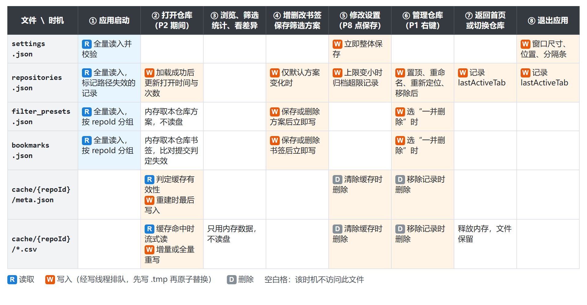

*图 13　持久化文件读写时机矩阵*

**① 应用启动**。 在显示 P1 之前，同步读取四个 JSON 文件，完成校验和分组（3.3.3 节的第 1～3 步），并清理残留的 .tmp 文件。这里之所以不用后台线程，是因为 P1 显示最近列表必须依赖这些数据，而文件总量只有几十 KB，预计耗时不超过几十毫秒，用户不会有感觉。缓存文件的内容此时不读取，否则启动时间会随仓库数量增长；启动时只列出 cache 目录下的子目录名，与仓库记录的 repoId 比对，删除没有对应记录的残留目录。

**② 打开仓库（P2 期间**）。 流程见 2.3.2 节，全部在后台线程中进行。先读 meta.json 判定，根据结果读取 CSV 或重写缓存；成功后才写 repositories.json。方案和书签已在启动时读入内存，这里不再读盘，只取本仓库的分组。

**③ 浏览、筛选、统计、看差异**。 这一阶段完全不访问持久化文件。提交数据在内存中；差异和提交说明正文来自 `git show`，只放入内存缓存。这是系统运行时间最长的阶段，同时也是磁盘上唯一“什么都不发生”的阶段，因此操作不会受到磁盘速度的影响。

**④ 增删改书签、保存筛选方案**。 用户点击保存后立即写入。这些是用户亲手创建的内容，如果等到退出时才保存，程序崩溃或断电就会丢失。设置或取消默认方案时，还需要写 repositories.json。

**⑤ 修改设置**。 在 P8 中点“保存”后立即写 settings.json。如果最近仓库数上限变小，超出的记录会被归档，同时写 repositories.json 并删除它们的缓存。“清除全部缓存”也在这一时机执行，它会先删除 meta.json，再删除 CSV，这样中途失败时也只是“缓存不完整、下次重建”。

**⑥ 管理最近仓库（P1 右键菜单**）。 置顶、重命名、重新定位、移除都会立即写 repositories.json。选择“一并删除”时，还要写 filter_presets.json、bookmarks.json，并删除缓存目录；三者的顺序在 3.7 节讨论。

**⑦ 返回首页或切换仓库**。 把当前子页记入 lastActiveTab 并写 repositories.json，同时释放会话占用的内存。缓存文件保留，下次打开时仍可以使用。

**⑧ 退出应用**。 把窗口位置、尺寸和分隔条位置写入 settings.json，把 lastActiveTab 写入 repositories.json。窗口状态只在退出时写，因为拖动窗口时每秒会产生几十次变化事件，如果实时写盘，既没有必要，也会造成大量无效的 I/O；万一程序崩溃，损失的也只是窗口位置，可以接受。退出时等待写线程处理完排队的任务，最多等待 3 秒，避免磁盘异常时窗口关不掉。

写入在实现上有三点共同的设计：

- **整文件重写**。 JSON 文件不支持只修改其中一条，所以每次都把内存中的完整数据写回。在几十 KB 的规模下，一次写入预计只需几毫秒，这比设计一套增量更新机制简单得多，也更不容易出错。
- **单线程写入**。 所有写操作都交给 PersistenceExecutor（单线程执行器），不会阻塞界面，也不会有两个线程同时写同一个文件。提交任务之前，JavaFX 应用线程先把对象序列化成字符串快照，写线程只处理这个不可变的字符串，不会接触可变对象，因此不存在并发修改的问题。
- **合并等待中的写入**。 如果同一个文件有多个写任务在排队，只保留最新的快照。例如用户连续快速删除多条书签时，只需要最后写一次，结果却完全相同。缓存的 CSV 数据量大，不生成字符串快照，而是由写线程流式遍历不可变的提交列表；P2 的后台任务会等待它完成，以保证三个文件的写入顺序。

**原子写入**。 每次写入都按以下步骤进行，保证在任何时刻崩溃，目标文件要么是完整的旧版本，要么是完整的新版本：

```text
1. 把新内容写入同一目录下的 bookmarks.json.tmp，调用 FileChannel.force(true) 确保落盘
2. 若 bookmarks.json 已存在，把它复制为 bookmarks.json.bak
3. Files.move(tmp, target, ATOMIC_MOVE, REPLACE_EXISTING)
   - 文件系统不支持 ATOMIC_MOVE 时，退回到普通的 REPLACE_EXISTING
   - Windows 上文件可能被杀毒软件短暂占用，移动失败时间隔 100 毫秒重试，最多 3 次
```

逐步分析崩溃的后果：第 1 步中崩溃，原文件没有变化，只留下一个 .tmp，下次启动时清理；第 2 步中崩溃，原文件仍然完整，.bak 即使不完整也不会被使用，因为只有原文件损坏时才会读取它；第 3 步由操作系统保证原子性，不存在“写了一半”的中间状态。临时文件必须与目标文件在同一目录，因为原子移动只能在同一文件系统内进行。

### 3.7 异常情况与数据一致性

本地文件没有数据库的事务和约束，文件可能被手工修改，程序也可能在任何时刻崩溃。表 18列出了可能出现的异常情况及其处理策略。总的原则是：**用户数据尽量保留和恢复，缓存数据发现问题就丢弃重建**。

**表 18　异常情况与处理策略**

| 场景 | 检测方式 | 处理策略 |
| --- | --- | --- |
| 写入时断电或崩溃 | 启动时发现残留的 .tmp；缓存目录缺少 meta.json | 用户文件因原子替换而保持完整，删除 .tmp 即可；缓存缺少 meta.json 时按无缓存处理，全量重建 |
| JSON 文件损坏（如手工改坏） | Gson 抛出解析异常 | 把原文件改名为 .corrupt-\<时间戳> 保留，尝试读取 .bak；.bak 也不可用时使用默认值或空列表。状态栏提示并提供“打开数据目录” |
| 字段值超出范围、记录不完整 | 加载时按 3.4 节的约束校验 | settings.json 中只把出错字段恢复为默认值；列表文件中跳过缺少主键或类型错误的记录，其余正常使用，跳过之前先把原文件复制为 .corrupt-\<时间戳>，防止下次保存时丢失 |
| 写缓存时被取消或失败 | 取消标志、IOException | 删除 .tmp，不写 meta.json，下次打开时重建。写缓存失败不影响本次打开，数据已在内存中，状态栏提示“未能写入缓存” |
| CSV 行数不符或存在孤儿行 | 读取时与 meta.json 核对 | 丢弃缓存，全量重建，状态栏提示“缓存损坏，已重新构建” |
| 历史被改写（rebase、reset 等） | `merge-base --is-ancestor` 判定旧 head 不是祖先 | 全量重建缓存；对应提交已不存在的书签标记为“已失效”，内容保留，由用户决定是否删除 |
| 同时启动两个实例 | `app.lock` 的 FileLock 获取失败 | 提示“程序已在运行”后退出。否则两个实例各有一份内存数据，后写入的整文件会覆盖先写入的修改 |
| 数据目录不可写 | 启动时创建目录或写入探测失败 | 进入只读模式：已有数据可以使用，修改只在本次运行中有效，状态栏持续警告；保存书签失败时对话框不关闭，用户可以把笔记复制出来 |
| 程序升级后文件版本变化 | 比较 schemaVersion | 低版本先备份再迁移；高版本只读不写回；缓存版本不一致时重建（见 3.5 节） |

**跨文件的一致性**。 原子写入只能保证单个文件完整，一次操作涉及多个文件时，则要靠安排写入顺序。本设计的方法是：**引用方先解除或删除，被引用方后删除**，这样无论在哪一步崩溃，都不会出现指向已删除数据的孤儿记录。具体有以下几处：

- **一并删除仓库**：依次删除该仓库的书签、方案，再删除仓库记录，最后删除缓存目录。如果在中途崩溃，最坏的结果是“仓库记录还在，但书签和方案已没有”或“缓存目录残留”，都不会出现“书签还在但所属仓库已消失”的孤儿数据。用户重新执行一次移除即可。残留的缓存目录会在下次启动时按 3.6 节①的方式被发现并删除。
- **保留书签与方案的移除**：只把 archived 改为 true，再删除缓存，不涉及用户数据的删除，所以不会产生孤儿。
- **删除默认方案**：先把仓库记录的 defaultPresetId 置为 null，再删除方案。即使顺序被打乱导致引用悬空，3.3.3 节的第 3 步也能在加载时修复。
- **写缓存的三个文件**：通过“先删 meta、最后写 meta”把多个文件变成一个整体，判断方法见 2.3.2 节。

这样一来，孤儿数据只可能来自手工编辑文件，而这种情况在 3.3.3 节第 2 步已经做了保守处理。

### 3.8 持久化测试要点

持久化层不依赖界面，可以用 JUnit 5 直接测试。测试中用到的仓库在 `@TempDir` 提供的临时目录中由 Git 命令现场创建，不依赖开发者本机的状态，数据目录也指向临时目录，不影响真实数据。测试要点如下：

- **JSON 往返**：每个实体保存后再读取，所有字段都应相等；特别检查 null、中文、含换行的笔记、含反斜杠的路径。
- **约束校验**：对 3.4 节每张表的边界值进行测试（如字号 11 / 12 / 20 / 21），确认修复行为符合预期。
- **损坏恢复**：写入截断的 JSON，确认原文件被改名隔离、从 .bak 恢复；.bak 也损坏时能回到默认值，程序不崩溃。
- **原子写入**：模拟写 .tmp 后、移动前中断，确认目标文件仍是旧内容，下次启动能清理 .tmp。
- **增量等于全量**：在同一仓库中先构建缓存，再新增若干提交并增量更新，结果应与重新全量构建逐行相同（排序后比较）。这个测试直接验证 2.3.2 节的推导。
- **历史改写**：用 `git commit --amend` 和 `git reset` 改写历史，确认程序转为全量构建，相应书签变为失效。
- **CSV 转义**：提交说明中包含逗号、引号、Emoji 和中文路径时往返不变；带 BOM 的文件能正确读取；用 Excel 打开时中文不乱码（手工检查）。
- **缓存校验**：删除 CSV 的一行、加入孤儿行、删除 meta.json，三种情况都应触发重建。
- **特殊仓库与单实例**：空仓库不建缓存并显示空状态；仓库有合并提交时增删行不重复统计；第二个实例获取锁失败后正常退出。

本文档给出的耗时和文件大小都是设计阶段的估算值，尚未经过实测。实现完成后，需要用实际仓库（包括一个上万次提交的大型仓库）测量，并根据结果调整。

## 四、小结

本文档完成了项目的原型设计和数据持久化设计。原型部分定义了 10 个页面及其布局，用 25 条跳转路径说明了触发条件和传递的数据；持久化部分确定了“用户数据用 JSON、分析缓存用 CSV”的方案，给出了 8 类数据结构的字段设计，并说明了文件间的关联方法、读写时机和异常处理。整个方案只使用本地文件，不依赖任何数据库。

表 19把开题文档中的验收标准逐条对应到本设计，确认没有遗漏。

**表 19　开题验收标准与设计的对应关系**

| 验收标准 | 设计中的落实 | 相关章节 |
| --- | --- | --- |
| 选择本地仓库并展示提交历史 | P1 提供拖放、目录选择和路径输入三种方式；P2 统一校验；P3 展示列表和时间线 | 2.2.1、2.2.2、2.3.2 |
| 支持按作者或时间筛选 | P3 筛选栏；FilterState 共享筛选条件；可保存为方案 | 2.2.2、2.3.3、3.4.4 |
| 至少一个作者贡献图和一个时间分布图 | P4 的作者柱状图、时间分布折线图，以及增删行堆叠图 | 2.2.3 |
| 查看提交的变更文件和文本差异 | P5 的文件列表来自缓存，差异由 `git show` 按需读取 | 2.2.4、3.4.8 |
| 无效路径、非 Git 目录、命令失败时给出明确提示而不崩溃 | 8 类错误的判定和提示；P9 消息提示；数据文件异常时自动恢复 | 2.2.6、3.7 |
| 交付源码、README、开题文档和测试说明 | 本文档提供设计依据；持久化测试要点作为测试说明的一部分 | 3.8 |

建议按以下顺序实现，每一步结束时都能得到一个可以运行和演示的版本，同时把风险最大的部分（Git 输出解析）尽早验证：

（1）搭建 Maven + JavaFX 项目，实现 GitService 和 `git log` 输出解析，并完成单元测试。

（2）实现持久化基础（原子写入、PersistenceExecutor、SettingsStore、RepositoryStore），完成 P1、P2 和最基本的 P3，打通“选目录 → 看历史”的主线。

（3）完成 P3 的筛选和摘要区，以及 P5 的差异查看，至此三项核心功能中的两项已可用。

（4）实现 StatsService 和 P4 的图表，完成全部核心功能。

（5）实现 AnalysisCache（全量、增量和校验），提升再次打开的速度。

（6）实现书签与筛选方案（P6、P7、P10）和设置页 P8。这部分属于辅助功能，时间紧张时可以削减。

（7）完善错误提示和空状态，用不同规模的仓库做集成测试，编写 README 和测试说明。
